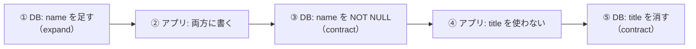

# 第46章 リリースと復旧

<div class="goal-box" markdown>

この章でできるようになること

- GitHub Actions の CI ワークフロー（`ci.yml`）を読み、何を守る設定かを説明できる
- 稼働中に列の名前を変える・列を消す変更が壊れる様子を再現し、**expand/contract** の3段階で直せる
- `pg_dump` / `pg_restore` で別のDBに復元し、**復元したDBでアプリが動く**ところまで確かめられる
- Spring Boot のパッチ版を追う方法と、依存・イメージの脆弱性を調べる方法を説明できる
- 第0〜9部の総まとめとして、**公開前チェックリスト**で自分のサービスを点検できる

</div>

## 1. 問いかけ：出すのは簡単、戻すのが難しい

フロントエンドのデプロイは、戻しやすい作業です。静的ファイルを前のバージョンに差し替えれば、元通りになります。

サーバーには、**DB** があります。新しいコードが DB のスキーマを変え、データを書き込んだ後に、コードだけ前のバージョンに戻しても、**DB は戻りません**。しかも、デプロイの最中は、新旧2つのバージョンが**同時に**動きます。

この章は、次の3つを扱います。

1. **壊れたコードを出さない**（CI）
2. **稼働中のDBを、壊さずに変える**（expand/contract）
3. **それでも壊れたとき、元に戻せる**（バックアップと復元）

最後に、第0〜9部の総まとめとして、公開前に確認することを一覧にします。

## 2. CI：mainに入る前に、必ず通す

!!! note "用語：CI（継続的インテグレーション）"
    コードを push するたびに、**自動でビルドとテストを実行する**仕組みです。人間が「テストを回し忘れた」「自分のPCでは通った」を防ぎます。GitHub では **GitHub Actions** が、`.github/workflows/*.yml` の定義に従って実行します。

QuickVote の CI は、`code/quickvote/.github/workflows/ci.yml` にあります。2つのジョブ（`verify` と `docker`）です。

```yaml title=".github/workflows/ci.yml（抜粋 1/2：いつ動くか、何を許すか）"
name: CI

on:
  push:
    branches: [main]
  pull_request:
  workflow_dispatch:          # (1)!

permissions:
  contents: read              # (2)!

concurrency:
  group: ci-${{ github.workflow }}-${{ github.ref }}
  cancel-in-progress: true    # (3)!
```

1. 手動でも実行できる
2. このワークフローが使える権限を**読み取りだけ**にする。CI の中のコードが乗っ取られても、リポジトリに書き込めない
3. 同じブランチに新しい push が来たら、古い実行は止める

```yaml title=".github/workflows/ci.yml（抜粋 2/2：verify ジョブ）"
jobs:
  verify:
    name: ./mvnw verify
    runs-on: ubuntu-latest
    timeout-minutes: 20       # (1)!
    steps:
      - uses: actions/checkout@v7

      - uses: actions/setup-java@v6
        with:
          distribution: temurin
          java-version: '25'
          cache: maven        # (2)!

      - name: Make Maven Wrapper executable
        run: chmod +x mvnw    # (3)!

      - name: Build and test
        run: ./mvnw -B -ntp verify   # (4)!

      - name: Upload test reports
        if: failure()         # (5)!
        uses: actions/upload-artifact@v7
        with:
          name: test-reports
          path: |
            target/surefire-reports/
            target/failsafe-reports/
```

1. テストが固まっても、6時間（既定）使い切らない
2. `~/.m2`（依存のダウンロード）を、`pom.xml` をキーにキャッシュする
3. Windows で作ったファイルを Git 経由で受け取ると、`mvnw` の実行権限が落ちていることがある（README の `chmod +x mvnw` と同じ理由）
4. `-B` はバッチモード（色や進捗を出さない）、`-ntp` は依存のダウンロード進捗を出さない。`verify` は、単体テスト（surefire）に加え、**Testcontainers を使う `*IT`**（failsafe）まで実行する
5. 失敗したときだけ、テストのレポートを保存する

`docker` ジョブは、`needs: verify` でテストが通ったあとに、`docker build` で `Dockerfile` が壊れていないかを確かめます（push はしません）。

### なぜ Testcontainers が動くのか

`ubuntu-latest`（GitHub が用意する実行環境）には、**Docker が入っています**。そのため、実PostgreSQLを起動する `*IT` が、自分のPCと同じようにそのまま動きます（第21章）。H2 などの代役を使わなくて済むのは、このためです。

!!! example "検証：この YAML は正しいか"
    GitHub 上で実行はしていません（リポジトリがないため）。代わりに、2つの方法で**書式と文法**を確かめました。
    ```bash
    python -c "import yaml; yaml.safe_load(open('.github/workflows/ci.yml'))"   # YAML として読める
    docker run --rm -v "$PWD:/repo" -w /repo rhysd/actionlint:latest .github/workflows/ci.yml   # 出力なし（終了コード 0）
    ```
    `actionlint` は、Actions のワークフロー専用の検査ツールで、式の誤りや存在しない項目を見つけます。指摘は0件でした。使っているアクションの版（`checkout@v7`、`setup-java@v6`、`upload-artifact@v7`）は、GitHub の API で最新のメジャー版であることを確認しました。

### CI のレビュー観点

| 見るもの | 疑う理由 |
| --- | --- |
| `permissions` がない | 既定の権限が広いことがある。最小にする |
| `uses: someone/action@main` | 動く参照。中身が変わると、気づかず実行される。タグ、できれば**コミット SHA で固定**する |
| 秘密（トークン）をログに出す | CI のログも、第43章と同じ「保管庫」 |
| テストが通らなくてもマージできる | ブランチ保護で、CI の成功を必須にする |
| `pull_request` に秘密を渡す | 外部の人の PR で、秘密が盗まれる経路になりうる |

## 3. 稼働中にDBを変える：expand と contract

### 状況：列の名前を変えたい

`polls.title` を `polls.name` に改名したいとします。`ALTER TABLE ... RENAME COLUMN` を1行流せば済む、と思いがちです。

**デプロイ中は、古いバージョンのアプリが動いています。** そこに DB の変更を当てると、何が起きるでしょうか。実験しました（`expand-contract.sh`）。稼働中のアプリ（古いバージョン）の DB に、変更を直接当てて、API の結果を見ます。

### 実験A：名前を変える（悪い例）

```sql
ALTER TABLE options RENAME COLUMN label TO text;
```

!!! question "予測カード"
    古いアプリが動いたままです。この直後に、投票の詳細取得と、投票の作成を呼ぶと、結果はどうなるでしょう。

```text
[0] 変更前                    → 詳細の取得=200  投票の作成=201
[A] RENAME 直後               → 詳細の取得=500  投票の作成=500
[A] 元に戻した後               → 詳細の取得=200  投票の作成=201
```

**両方 500** です。古いコードの SQL は `options.label` を探します。ログには `SQLSTATE=42703`（`undefined_column`）が残りました。デプロイ中ずっと、全員がエラーになります。

### 解決の考え方：expand と contract

!!! note "用語：expand／contract"
    **expand（広げる）**：新しいものを**足す**。古いものはそのまま。古いアプリも新しいアプリも動く。
    **contract（絞る）**：古いものを**消す**。全部のアプリが新しいものだけを使うようになってから。
    1回の変更を、**複数回のリリースに分けて**行う方法です。

`title` → `name` の改名は、次の順番です。

| 段階 | DB | アプリ | 古いアプリは？ |
| --- | --- | --- | --- |
| ① expand | `name` 列を**足す**（NULL可）。既存の行を埋める（バックフィル） | （まだ変更なし） | 動く |
| ② 新アプリを出す | — | `title` と `name` の**両方に書く**。読むのは `name`（なければ `title`） | 新旧が混在しても動く |
| ③ contract その1 | `name` を `NOT NULL` にする | 全台が新アプリであることを確認済み | **古い台が残っていると壊れる** |
| ④ アプリを直す | — | `title` を読み書きしない版を出す | — |
| ⑤ contract その2 | `title` 列を**消す** | 全台が④であることを確認済み | **古い台が残っていると壊れる** |



①〜⑤を、1つのリリースにまとめてはいけません。**各段階のデプロイが完全に終わり、古いバージョンがどこにも動いていないこと**を確かめてから、次へ進みます。

このように、マイグレーションを3つの版に分けます（`code/labs/ch46-release/migrations/`）。リファレンス実装に V6 があるので、続きの番号を使います。

```sql title="V7__expand_add_polls_name.sql（expand）"
ALTER TABLE polls ADD COLUMN name text;
UPDATE polls SET name = title WHERE name IS NULL;   -- バックフィル。大きな表では件数を区切る
```

```sql title="V8__contract_polls_name_not_null.sql（contract その1）"
ALTER TABLE polls ALTER COLUMN name SET NOT NULL;
ALTER TABLE polls ADD CONSTRAINT polls_name_check CHECK (char_length(name) >= 1);
```

```sql title="V9__contract_drop_polls_title.sql（contract その2）"
ALTER TABLE polls DROP COLUMN title;   -- 元に戻せない。戻すならバックアップから
```

### 実験B：列を足すだけなら、安全か

V7（expand）を、古いアプリが動いたまま当てます。

```text
[B] V7 適用後（name 列が増えた）  → 詳細の取得=500  投票の作成=201
[B] もう一度                      → 詳細の取得=200  投票の作成=201
```

**1回だけ、500 が出ました。** 列を足しただけなのに、です。ログを見ると、原因は別の種類のエラーでした。

```text
ERROR: cached plan must not change result type     （SQLSTATE 0A000）
SQL [SELECT * FROM polls WHERE id = ?]
```

PostgreSQL のドライバは、同じ SQL を速く実行するために、**文のひな形（プリペアドステートメント）を接続ごとに覚えます**。`SELECT *` の結果の列が変わると、覚えていたひな形が合わなくなり、1回失敗してから作り直します。実測では、列を足した直後（`ADD COLUMN`）と列を消した直後（`DROP COLUMN`）の連続25回で、**失敗はそれぞれ1回**だけで、すぐ元に戻りました。

QuickVote の `PollRepository` には `SELECT * FROM polls` が3か所あります。**列を明示する**（`SELECT id, public_id, title, ...`）と、この1回の失敗は避けられます。接続が複数あれば、接続ごとに1回ずつ起こりえます。

!!! tip "expand が「安全」であることの意味"
    expand は、**ほぼ**安全です。完全にゼロではなく、`SELECT *` のようにスキーマの形に依存した書き方があると、一瞬の失敗が出ます。デプロイの手順に「失敗は1〜数回ありうる」と織り込んでおくか、列を明示して避けます。

### 実験C：contract を早まる

V7 のあとにも、**古いアプリは `name` を書かないまま行を作り続けます**。実験では、V7 で 291 行をバックフィルしたあとに、古いアプリが作った行が 2 行（`name` が NULL）ありました。この状態で `NOT NULL`（V8）を当てると、次のエラーで止まります。

```text
ERROR:  column "name" of relation "polls" contains null values
```

急いで、もう一度バックフィルをしてから V8 を当てるとどうなるでしょう（実験で再現）。

```text
[C] V8 適用後（古いアプリは name を書かない） → 詳細の取得=200  投票の作成=500
```

詳細の取得は動きますが、**投票の作成は 500** です（ログに `SQLSTATE=23502`、`not_null_violation`）。古いアプリが `name` を書かない INSERT を流すからです。contract は、**古いアプリが完全にいなくなってから**です。

### リファレンス実装の V6 も同じ考え方

リファレンス実装には、すでに「適用済みの版を直す」例があります。V2 で作った外部キーに不備があり、**V2 は書き換えず**、新しい版（V6）で直しています（第17章：Flyway は DB の Git。書き換えるとチェックサムエラー）。

```sql title="src/main/resources/db/migration/V6__options_created_by_composite_fk.sql（抜粋）"
ALTER TABLE options
    DROP CONSTRAINT options_created_by_fkey;

ALTER TABLE options
    ADD CONSTRAINT options_created_by_fkey FOREIGN KEY (poll_id, created_by)
        REFERENCES participants (poll_id, id) ON DELETE CASCADE;
```

ファイルの冒頭のコメントには、運用の注意が書かれています。`ADD CONSTRAINT` は**既存の全行を検査する**ので、違反する行が1行でもあると失敗します。Flyway はこの版をトランザクションで流すので、失敗しても**途中まで適用された状態にはなりません**。行数の多い本番の表では、`NOT VALID`（新しい行だけ先に検査）で足してから、別の版で `VALIDATE CONSTRAINT` する方法がある、と書いてあります。

### 変更の危険度（早見表）

| 変更 | 稼働中に当てて安全か | 注意 |
| --- | --- | --- |
| 列を足す（NULL可） | ほぼ安全 | `SELECT *` で1回失敗することがある（実測） |
| 列の名前を変える | **危険**（実測：全員 500） | 新しい列を足して移す（expand/contract） |
| 列を消す | **危険** | 全台が使わなくなってから |
| `NOT NULL` を足す | 古いアプリが書かないと壊れる（実測） | 全台が書くようになってから。既存の行に NULL がないことも確認 |
| 制約（外部キー・CHECK）を足す | 全行を検査する | 大きな表は `NOT VALID` → 別の版で `VALIDATE` |
| インデックスを足す | 表の書き込みを止めることがある | `CREATE INDEX CONCURRENTLY`（ただし、トランザクション内では使えない） |

### ロールバックと「古いアプリ × 新しいスキーマ」

デプロイを戻すとき、**コードは戻せても DB は戻りません**。実験で、5本のマイグレーションしか知らない古いイメージを、V6 まで適用済みの DB に向けて起動しました。

```text
Schema "public" has a version (6) that is newer than the latest available migration (5) !
Schema "public" is up to date. No migration necessary.
```

Flyway は**警告を出すだけで止めません**。アプリは起動し、API も動きました。つまり、**戻せるかどうかは、スキーマの変更が後ろ向きに互換かどうか**で決まります。expand だけなら古いアプリに戻せます。contract まで進めたあとは、戻せません。

## 4. バックアップと復元：復元できて、はじめてバックアップ

どれだけ慎重にやっても、人は誤って `DELETE` を流し、ディスクは壊れます。最後の砦が、バックアップです。

!!! note "用語：RPO／RTO"
    **RPO**（復旧時点目標）：**どれだけ前のデータまで失ってよいか**。1日1回のバックアップなら、最大1日分を失う。
    **RTO**（復旧時間目標）：**止まってから、どれだけで復旧するか**。
    バックアップの頻度と方式は、この2つから逆算して決めます。

### 実験：取って、別のDBに戻して、アプリを動かす

`backup-restore.sh` が、次を行いました。

```bash
# 1. バックアップ（-Fc はカスタム形式。圧縮され、pg_restore で部分復元もできる）
docker exec qv46-postgres-1 pg_dump -U quickvote -d quickvote -Fc -f /tmp/quickvote.dump

# 2. 空の PostgreSQL を別に起動して、3. 復元する
docker exec qv46-restore pg_restore -U quickvote -d quickvote --no-owner --exit-on-error /tmp/quickvote.dump
```

```text
ダンプのサイズ: 50,427 byte
元のDB:       288 polls / 324 options / 2 votes / 96 visitors / 6 migrations   ← ※復元前に数えた値
復元前のテーブル数: 0
pg_restore 終了コード 0
復元後:       288 polls / 324 options / 2 votes / 96 visitors / 6 migrations
```

行数が一致しました。次に、**復元したDBに向けてアプリを起動**します。

```text
Successfully validated 6 migrations
Schema "public" is up to date. No migration necessary.         ← Flyway はマイグレーションを再実行しない
--- 元のアプリで作った投票を、元の Cookie のまま、復元したアプリで取得
HTTP 200
title = 復元テスト用の投票 / role = HOST / myVote = 337 / options = [('カレー', 1), ('ラーメン', 0)]
```

`flyway_schema_history` も一緒に戻っているので、Flyway は「適用済み」と判断します。訪問者のテーブルも戻っているので、元の Cookie で**元の主催者として**操作できました。復元のテストはこの水準（**復元したDBでアプリが起動し、主要な操作ができる**）まで行います。

### バックアップの運用

| 項目 | 方針 |
| --- | --- |
| 方式 | `pg_dump`（論理バックアップ）は、手軽で復元先を選べる。ある時点まで巻き戻したい（PITR）なら、WAL アーカイブを使う物理バックアップが別に要る（この教材では扱わない） |
| 頻度 | RPO から決める。1日1回なら、最大1日分を失う前提 |
| 保管場所 | **DB と別の場所**に置く。同じサーバーのディスクでは、そのサーバーと一緒に失う |
| 内容の機密性 | ダンプには、訪問者トークンの**ハッシュ**、参加コード、投票の内容が入る。ログと同じく保管庫なので、暗号化とアクセス制限を |
| 復元テスト | **定期的に**、手順どおりに実行する。取れていないバックアップより、**戻せないバックアップ**の方が怖い |
| 手順書 | 復元の手順を文書にし、誰でも実行できるようにしておく。事故のときに初めて読むものにしない |

!!! danger "本番で事故になるパターン：復元を一度も試していないバックアップ"
    「毎日取っています」は、復元できることの証明ではありません。権限が足りない、バージョンが合わない、ダンプが空、など、取る側は成功して復元側で初めて失敗が分かるものがあります。
    復元を試すと、`flyway_schema_history` の扱い、起動時間（RTO の見積もり）、必要な手順の抜けまで見つかります。

## 5. 依存の更新と脆弱性

公開したあとも、ライブラリは更新され続けます。**既知の脆弱性が見つかった版を動かし続ける**ことが、最大のリスクです。

### Spring Boot は、パッチ版を追う

Spring Boot は、1つのマイナー版（例：4.1）の中で、パッチ版（4.1.1、4.1.2、…）を出し続けます。Maven Central のメタデータと GitHub のリリースで確認すると、2026年11月8日時点で、次のとおりでした。

```text
4.1.x : 4.1.0, 4.1.1, 4.1.2（2026-10-22 公開。4.1 系の最新）
4.0.x : …, 4.0.9（同じ日に公開）
4.2.0-RC2（2026-11-05 公開。まだ正式版ではない）
```

QuickVote が使う 4.1.2 は、4.1 系の最新です。同じ日に別の系列（4.0.9）も更新されているように、**修正は、サポート中の系列にまとめて出ます**。方針は2つです。

1. **パッチ版は、すぐ追う**。同じマイナー版の中の更新なので、互換性が保たれる前提で、CI が通れば出す
2. **マイナー版（4.1 → 4.2）は、移行ガイドを読んで計画的に上げる**。RC（候補版）は本番に使わない

親 POM の更新は、Maven のプラグインで調べられます。

```bash
./mvnw versions:display-parent-updates -Dmaven.version.ignore='.*-(M|RC)[0-9]+'
```

```text
The parent project is the latest version
```

`-Dmaven.version.ignore` で、マイルストーン（M）と候補版（RC）を除くのが大事です。これなしだと、`4.1.2 -> 4.2.0-RC2` と表示されます（実測）。

依存ライブラリ（`display-dependency-updates`）は、**Boot が管理している版**の一覧がそのまま出るので、ほとんどがノイズです。

```text
ch.qos.logback:logback-classic ...... 1.5.38 -> 1.6.6
com.fasterxml.jackson.core:jackson-annotations ... 2.21 -> 3.0-rc5
```

これらは、Boot が意図して採用していない版です。**個別に上書きしない**（BOM に従う、第10章）のが原則で、更新は Boot のパッチ版を上げることで受け取ります。

### 自動で気づく：Dependabot

人が毎週調べるのは続きません。Dependabot のような仕組みに、更新の提案（プルリクエスト）を任せます（`dependabot.yml.example`。GitHub 上で動かしてはいません）。

```yaml title=".github/dependabot.yml（例）"
version: 2
updates:
  - package-ecosystem: maven
    directory: /
    schedule: { interval: weekly }
    groups:
      spring-boot:
        patterns: ["org.springframework.boot*"]
  - package-ecosystem: docker          # Dockerfile のベースイメージ
    directory: /
    schedule: { interval: weekly }
  - package-ecosystem: github-actions   # ワークフローの uses:
    directory: /
    schedule: { interval: weekly }
```

提案が来たら、CI（`ci.yml`）が自動でテストを回します。**CI が通れば取り込める**。CI の信頼が、更新を速く安全にします。

### イメージの脆弱性を調べる：Trivy

アプリのライブラリだけでなく、イメージの中の **OS のパッケージ**にも脆弱性があります。`Trivy` というツールで、第42章のイメージを調べました。

```bash
docker run --rm -v //var/run/docker.sock:/var/run/docker.sock aquasec/trivy:latest image --scanners vuln --severity HIGH,CRITICAL qv42-app:latest
```

```text
アプリの jar（65 個）          : HIGH / CRITICAL の脆弱性 0 件
OS（ubuntu 26.04）のパッケージ  : 2 件（apt、libapt-pkg7.0。CVE-2026-109518、重大度 HIGH。修正版 3.2.1ubuntu0.1 あり）
```

アプリの依存は問題なく、**ベースイメージの OS 層**に1件の指摘がありました。直し方は、ベースイメージを更新して**再ビルド**することです（`Dockerfile` を変えなくても、中身が変わる）。

脆弱性が見つかったときの手順を決めておきます。

1. **影響を判断する**。その機能は QuickVote で使われているか（到達できるか）
2. **修正版へ上げる**（パッチ版、ベースイメージの更新）
3. **CI を通して出す**（第3節の手順で、DB を壊さないように）
4. 見つけた日付、判断、対応を**記録する**

## 6. 公開前チェックリスト：第0〜9部の総まとめ

ここまでの全章を、公開前の点検表にまとめます。**自分のサービスを、1項目ずつ確かめてください。** 説明や再現ができない項目は、右の章に戻ります。

### 守るべき約束（第0〜5部）

- [ ] **環境**：JDK・Docker・`./mvnw` で、他人のPCでもビルドして起動できる（[第1章](../part00/ch01-setup.md)）
- [ ] **共有状態**：Bean（`@Service` など）のフィールドに、リクエスト固有の値や可変の状態がない（[第9章](../part01/ch09-threads.md)）
- [ ] **入力**：JSON 境界で欠落・null・未知の項目・巨大な本文を扱い、Entity ではなく DTO を返す（[第13章](../part02/ch13-api-contract.md)）
- [ ] **エラー**：想定内は 4xx と `code`、想定外は 500 でスタックトレースを外に出さない（[第14章](../part02/ch14-validation-errors.md)）
- [ ] **設定**：秘密が Git とイメージにない。必須の設定がなければ起動時に落ちる。`prod` を指定して起動する（[第15章](../part02/ch15-configuration.md)）
- [ ] **スキーマ**：適用済みの版を書き換えず、新しい版を足す。守りたい条件は DB の制約にも書く（[第17章](../part03/ch17-postgres-flyway.md)・[第18章](../part03/ch18-data-modeling.md)）
- [ ] **テスト**：実PostgreSQLで、制約・ON CONFLICT・タイムゾーンを通すテストがある（[第21章](../part03/ch21-testcontainers.md)）
- [ ] **同時実行**：上限（人数・件数）は、親行ロックなどで同時でも守られる。競合を狙ったテストで確かめている（[第25章](../part04/ch25-locking.md)・[第26章](../part04/ch26-concurrency-testing.md)）
- [ ] **トランザクション**：業務操作の単位に境界があり、トランザクション中に外部通信をしない（[第22章](../part04/ch22-transactions.md)・[第24章](../part04/ch24-connection-pool.md)）
- [ ] **再送**：副作用のある POST は、再送されても二重に起きない（[第27章](../part05/ch27-idempotency.md)）
- [ ] **時間**：期限の判定は `Clock` で、境界（直前・ちょうど・直後）のテストがある。締切と物理削除を分けている（[第28章](../part05/ch28-time-expiry.md)）
- [ ] **定期処理**：件数を区切り、途中で失敗しても再実行でき、複数台で重複して動かない（[第29章](../part05/ch29-scheduling.md)）

### 他人に触られても壊れない（第6〜8部）

- [ ] **認可**：権限表があり、非参加者・権限なしの操作が 404／403 で拒否される。存在を漏らさない（[第30章](../part06/ch30-authz-design.md)）
- [ ] **識別**：トークンは十分な長さの乱数で、DB にはハッシュだけ。Cookie の属性（HttpOnly・Secure・SameSite）を設定している（[第32章](../part06/ch32-anonymous-session.md)）
- [ ] **総当たり**：参加コードなど推測されうる入口に、試行回数の制限がある（[第33章](../part06/ch33-invites-brute-force.md)・[第35章](../part06/ch35-rate-limiting.md)）
- [ ] **ブラウザ境界**：CSRF 対策、CORS の理解、HTTPS 終端、セキュリティヘッダーを説明できる（[第34章](../part06/ch34-browser-boundary.md)）
- [ ] **リアルタイム**：SSE は認可されて接続し、再接続で取りこぼしを補い、書き込みが詰まった購読者を打ち切る（[第36章](../part07/ch36-sse.md)・[第37章](../part07/ch37-event-history.md)）
- [ ] **複数台**：メモリ上の状態（レート制限・購読者名簿・スケジューラ）が2台でどう振る舞うかを知っている（[第38章](../part07/ch38-multi-instance.md)）
- [ ] **JPA を使うなら**：発行されるSQLの本数を数え、N+1・OSIV・Lazy を点検している（[第40章](../part08/ch40-n-plus-one.md)）

### 運用（第9部）

- [ ] **イメージ**：マルチステージ・layered jar・非root。メモリ制限を付け、`MaxRAMPercentage` を `PrintFlagsFinal` で確かめた（[第42章](ch42-docker.md)）
- [ ] **ログ**：構造化・相関ID。許可した項目だけ出し、例外は型・SQLSTATE・スタックだけ。出す場所は1か所。秘密がログにないことをテストで確かめる（[第43章](ch43-logging.md)）
- [ ] **ログの穴**：フレームワークが出す例外（フィルタの中、トランザクションのロールバック）が、同じ方針を通っているか確認した（[第43章](ch43-logging.md)）
- [ ] **ヘルス**：readiness は DB を含み、liveness は含まない。管理ポートは外に出ていない（[第44章](ch44-metrics.md)）
- [ ] **指標とアラート**：HTTP・DB プール・JVM の指標を見られ、症状で鳴るアラートがある。タグに ID を入れていない（[第44章](ch44-metrics.md)）
- [ ] **タイムアウト**：HTTP クライアント・Hikari・`statement_timeout`・SSE・停止の猶予を、全部決めて表にした（[第45章](ch45-performance.md)）
- [ ] **負荷試験**：p95 / p99 の閾値を書いた k6 を回し、限界を知っている（[第45章](ch45-performance.md)）
- [ ] **停止**：graceful shutdown を有効にし、実行基盤の猶予をアプリの待ち上限より長くした（[第45章](ch45-performance.md)）
- [ ] **CI**：push のたびに `./mvnw verify` と `docker build` が通る。マージには CI の成功が必須（この章）
- [ ] **スキーマ変更**：稼働中に列を消す・名前を変えない。expand → contract の順（この章）
- [ ] **復元**：バックアップを取り、**別の場所に復元してアプリが動く**ことを、手順書どおりに確かめた（この章）
- [ ] **更新**：Boot のパッチ版を追う仕組み（Dependabot など）と、脆弱性を調べる手順がある（この章）

!!! tip "使い方"
    公開の直前だけでなく、**機能を足すたびに**見直すと効きます。特に「他人に触られても壊れない」と「運用」の項目は、後から足すほど手間がかかります。この表は、第48章の卒業制作でも使います。

## 7. 現場ではこうする

| 項目 | 方針 |
| --- | --- |
| リリースの単位 | **小さく**、頻繁に。大きな変更は、段階（expand → contract）に分ける |
| 戻し方 | コードは戻せる前提、DB は戻せない前提で、スキーマ変更を後ろ向き互換にする |
| デプロイ中の混在 | 新旧が同時に動く時間があるものとして、スキーマと API を設計する |
| 失敗の検知 | 出した直後に、エラー率とリクエストの遅さ（第44章）を見る。悪化したら戻す |
| バックアップ | 取る・保管する・復元を試す、の3点セット。復元の所要時間を RTO の根拠にする |
| 更新 | パッチ版は速く、マイナー版は計画的に。CI の信頼が前提 |
| 記録 | 何を、いつ、なぜ変えたか。マイグレーションのコメントに理由を書く（V6 のように） |

## まとめ：3点セット

!!! abstract "この章の3点セット"
    **① 一言で言うと**
    CI（`./mvnw verify`）でテストを通ったものだけを出し、稼働中のスキーマ変更は expand（足す）→ contract（消す）の段階に分けて、新旧が混在しても動くようにする。バックアップは復元して初めて有効で、依存は Boot のパッチ版を追い、イメージの脆弱性も調べる。

    **② 現場でこう聞かれる**
    「`title` 列を `name` に改名するマイグレーションを、いつものデプロイで出してよいですか？」
    → 出してはいけない。古いバージョンが動いている間、`RENAME` は全リクエストを 500 にする。`name` を足す → 両方に書くアプリを出す → `NOT NULL` → `title` を使わない版を出す → `title` を消す、の順に、各段階のデプロイが完了してから進める。

    **③ 自分のサービスならどこに当たるか**
    自分のサービスで「列の追加・改名・削除」を1つ想定し、①〜⑤の表を書く。さらに、バックアップを取って別のDBに復元し、アプリを起動できるか、実際に確かめる。

## 演習

??? question "確認問題1：予測と実行"
    稼働中のアプリに、`ALTER TABLE polls ADD COLUMN description text NOT NULL;`（`DEFAULT` なし）を当てるとどうなりますか。既存の行があるときと、ないときで答えてください。

??? success "解答"
    既存の行があると、`column "description" of relation "polls" contains null values` で**失敗**します（`NOT NULL` の列は、既存の行に入れる値がないため）。行がない表なら成功しますが、その後、古いアプリが `description` を書かない INSERT を流すと、`not_null_violation`（23502）で**全部失敗**します。必須の列を足すには、まず NULL 可で足し、両方に書くアプリを出し、バックフィルしてから `NOT NULL` にします（第17章の予告の答え）。

??? question "確認問題2：コードを戻す"
    V8（`NOT NULL`）まで適用したあとで、バグが見つかり、アプリを1つ前のバージョン（`name` を書かない）に戻したいです。何が起きますか。どうしますか。

??? success "解答"
    古いアプリは `name` を書かないので、投票の作成が `NOT NULL` 違反で失敗します（実験C）。選択肢は2つです。(1) V8 の逆（`ALTER COLUMN name DROP NOT NULL`）を**新しい版**として流してから戻す（適用済みの V8 は書き換えない）。(2) 戻さずに、バグを直した新しい版を出す。contract まで進めると戻せなくなる、が教訓です。だから contract は、新しい版が十分安定してから行います。

??? question "応用：復元の手順書を書く"
    QuickVote の DB が壊れたとして、バックアップから復元して公開を再開するまでの手順を、番号つきで書いてください（10行以内）。

??? success "解答"
    例：(1) 公開を止める（アプリを停止、またはメンテナンス表示）。(2) 最新のダンプを、保管場所から取得。(3) 空の PostgreSQL を用意（新しいコンテナ、バージョンは同じ 18）。(4) `pg_restore --no-owner --exit-on-error` で復元。(5) 行数と、`flyway_schema_history` の件数を確認。(6) 復元したDBにアプリを向けて起動。(7) readiness が UP になるのを待つ。(8) 既存の投票を1つ取得し、主要な操作（参加・投票）を確認。(9) 公開を再開。(10) 失った期間（RPO）を記録し、利用者に知らせる。この手順を、実際に1回通しておくことが大事です。

??? question "説明問題：現場でこう聞かれる"
    「毎日バックアップを取っているので、データは安全ですよね？」200字程度で答えてください。

??? success "解答"
    例：取っているだけでは安全とは言えません。復元できて初めて有効です。権限不足、バージョンの不一致、ダンプが空などは、復元しないと分かりません。別の場所に復元してアプリを起動し、主要な操作ができることまで定期的に確認します。保管場所は DB と別にし、ダンプには機密が入るので暗号化とアクセス制限を行い、失ってよいデータの量（RPO）と復旧時間（RTO）を決めておきます。
