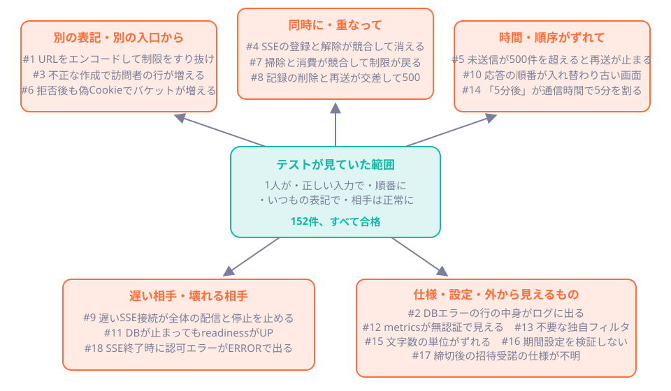
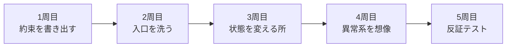

# 第47章 AIと組むレビュー術

<div class="goal-box" markdown>

この章でできるようになること

- 「テストが全部通っているのに穴がある」理由を、QuickVote で実際に見つかった18件で説明できる
- 32項目のチェックリストを使って、AIが書いた Spring のコードを観点ごとに読める
- 古い世代の書き方（Boot 3以前・Jackson 2など）を grep・コンパイル・テストで見抜き、直せる
- 欠陥入りのコードを読み、何が起きるか・どう見つけるか・どう直すか・どのテストで示すかを言える

</div>

この章は読解の章で、書くことより読むことを練習します。後半の演習では、コンパイルが通って一見きれいに動く3本のコードを、読者自身がレビューします。

## 1. 問いかけ：152件のテストが通っていたのに

QuickVote のリファレンス実装は、最初に完成した時点で152件のテストがすべて通っていました。AIが書いたコードを、AIが書いたテストで確かめた結果です。

そのあと、別のレビュアー（シニアの目）が読み、補助検証を流したところ、18件の問題が見つかりました。URLを1文字エンコードするだけで回数制限をすり抜けられる、DBのエラーメッセージ経由で入力した文字列がログに出る、遅いSSE接続が1本あるだけでアプリの停止まで止まる、といったものです。修正後のテストは258件（単体113件＋統合145件）に増えました。18件の内訳は、重大度が高いものが3件、中が9件、低が5件で、残りの1件は監督が実行ログを見て見つけたもの（SSE終了時の `ERROR`）です。

!!! question "予測カード"
    152件のテストが通っていたコードに、18件も穴があったのはなぜでしょう。次のうち、いちばん近い説明を選んでください。

    - (a) テストの数が足りなかった
    - (b) テストが「正常に動く1通り」を確かめていて、「破ろうとする操作」を確かめていなかった
    - (c) AIがテストを書いたので、手を抜いた

答えは (b) です。テストの数を増やしても、同じ方向のテストを重ねるだけでは穴は見つかりません。

## 2. 18件の実例：穴はどの方向にあったか

18件を一覧にします。「テストが見逃した理由」が、そのままレビューで探す場所になります。

| # | 重大度 | 何が問題だったか | テストが見逃した理由 | 対応する観点 |
| --- | --- | --- | --- | --- |
| 1 | 高 | URLをエンコード（`/api/%6aoin`）すると回数制限をすり抜ける | 通常の表記でしか試していない | A3 |
| 2 | 高 | 例外をそのままログに渡し、DBエラーに含まれる行の中身が出る | 「自分で連結しなければ安全」と思い込んでいた | L2 |
| 3 | 高 | 不正な作成・招待受諾でも訪問者の行が無制限に増える | 正しい入力でしか試していない | A4 |
| 4 | 中 | SSEの登録と最後の解除が競合し、新しい購読が名簿から消える | 競合を狙って作っていない | J1・E1 |
| 5 | 中 | 未送信が500件を超えると再送が止まる | 500件を超える件数で試していない | E2 |
| 6 | 中 | IP制限で拒否した後も、偽Cookieごとにバケットが増える | 拒否された後の副作用を見ていない | A4 |
| 7 | 中 | 掃除と消費が競合し、制限がリセットされる | 競合を狙って作っていない | C1 |
| 8 | 中 | 冪等性の記録が期限切れで消えると、再送が500になる | 削除と再送が交差する時間を作っていない | I1 |
| 9 | 中 | 遅いSSE接続が、他の配信・定期処理・停止まで止める | 読まないクライアントを作っていない | E3 |
| 10 | 中 | 応答の順番が入れ替わると、画面が古い状態に戻る | 応答を遅らせていない | B3 |
| 11 | 中 | readinessがDBを確認していない | DBを止めていない | O1 |
| 12 | 中 | 本番で metrics が無認証で外から見える | 本番設定で外から叩いていない | O1 |
| 13 | 低 | 不要な独自CSRFフィルタ。説明も誤っていた | 古い世代の知識が混ざった | S1 |
| 14 | 低 | 「5分後」が通信時間のぶん短くなって拒否される | 時計がずれる条件を作っていない | J3 |
| 15 | 低 | 100文字の数え方（コードポイント）と画面の `maxlength` が不一致 | 絵文字で試していない | J3 |
| 16 | 低 | 期間設定の検証がなく、`0s` でも起動してしまう | 範囲外の設定で起動していない | S5 |
| 17 | 低 | 締切後の招待受諾の仕様が不明で、実装と実装メモが食い違う | 仕様を言葉にしていない | 第48章 |
| 18 | （監督） | SSE終了時に `AuthorizationDeniedException` が `ERROR` で出る | 実行ログを読んでいない | E1 |

出典は、`production/design/review-codex.md`（1〜17）と `code/quickvote/IMPLEMENTATION_NOTES.md` の10章（修正の記録。18を含む）です。



18件は5つの方向に分かれます。テストが見ていたのは、図の中央の範囲だけでした。

| 方向 | 問いかけ（レビューで自分に聞く） |
| --- | --- |
| 別の表記・別の入口 | 同じことを、別の書き方・別の経路・Cookieなしでやったら？ |
| 同時に・重なって | 2つが同時に来たら？ 掃除と処理が重なったら？ |
| 時間・順序のずれ | 順番が入れ替わったら？ 件数が増えたら？ 時計がずれたら？ |
| 遅い相手・壊れる相手 | 相手が遅い・読まない・落ちたら？ |
| 仕様・設定・外から見えるもの | ログ・応答・設定・メトリクスに、何が出ている？ 仕様は言葉になっている？ |

### 2.1 掘り下げ：高の1件（URLのエンコード）

回数制限のフィルタが、URLを文字列で比較していました。

```java
// 指摘された書き方を単純にしたもの: 生の文字列を比べる
if ("POST".equals(request.getMethod()) && "/api/join".equals(request.getRequestURI())) {
    // 回数制限をかける
}
```

`getRequestURI()` はデコード前の文字列（`/api/%6aoin`）を返します。一方、Spring MVC は各セグメントをデコードして `/api/join` として処理します。そのため、制限のフィルタは素通りし、MVC は参加の処理をしてしまいます。補助検証では、通常のURLは101回中1回拒否、エンコードしたURLは101回すべて通過しました。

直し方は、MVCと同じ規則でパスを判定する `PathPatternRequestMatcher` を使うことでした（`security/EntryMatchers`）。判定は、処理する側と同じ道具で行うというのが教訓です。

### 2.2 掘り下げ：「連結しなければ安全」（ログと例外）

コメントには「入力値を連結しなければログに残らない」と書いてありましたが、これは誤りです。`log.error("...", ex)` は原因例外（cause）のメッセージも出力します。PostgreSQLのCHECK制約違反のメッセージには `Failing row contains (...)` で、違反した行の中身（投票のタイトルや参加コード）が入っています。

読むだけでは気づきにくい点でした。見つかったのは、時計を作成時刻より前に戻して制約違反を起こすという、異常系を狙ったテストからです。直し方は、例外の「型・SQLSTATE・スタックのフレーム」だけを許可して出す `SafeThrowable` です（[第43章](../part09/ch43-logging.md)）。

## 3. レビューの読み方：5周する

コードを上から順に読むと、「それらしい」部分に引きずられます。そこで、目的を変えながら5周します。



1. 約束を書き出す：コードを読む前に、このコードが守るべき約束（上限・一意・権限・期限）を3〜5個書く。書けないなら、仕様の問題です（[第48章](ch48-capstone.md)）
2. 入口を洗う：Controller・Filter・設定を見て、誰が・何を呼べるかを権限表と突き合わせる
3. 状態を変える所：`INSERT`・`UPDATE`・外部送信の周りに、トランザクション・ロック・制約・冪等性があるか
4. 異常系を想像する：各行で「ここで例外が出たら」「ここで相手が遅かったら」「ここが2つ同時に動いたら」
5. 反証テストを書く：疑いをテストにして確かめる。読んだだけの指摘より、赤いテスト1本のほうが説得力がある

!!! tip "フロントエンドで例えると"
    React の `useEffect` の依存配列を読むとき、「正常に動く順序」だけでなく、「アンマウント後に応答が返ったら」「2回続けて発火したら」も考えるのと同じです。違いは、サーバーでは間違いが画面に出ないことです。出ないので、テストで出させる必要があります。

## 4. レビュー観点チェックリスト（32項目）

10の分類に分けました。「疑うサイン」は読んで、または grep で見つけるもの、「確かめ方」は反証テストの作り方です。章番号は、その観点を学んだ章です。

### 4.1 Java

| ID | 観点：疑うサイン | 確かめ方 | 章 |
| --- | --- | --- | --- |
| J1 | 共有される可変状態：`@Service`・`@Controller` の非 `final` フィールド、`static` な `List`/`Map`、`HashMap` のキャッシュ | 2つのリクエストを途中で止めて交差させる | [9](../part01/ch09-threads.md)・[11](../part02/ch11-di-container.md) |
| J2 | 例外と null：`catch (Exception e)` でログだけ、`printStackTrace`、`Optional.get()`、`null` を返す | 例外を投げる偽物を差し、結果とDBを見る | [5](../part01/ch05-null-exceptions.md) |
| J3 | 値の型：率に `double`、絶対時刻に `LocalDateTime`、文字数に `length()`、`==` で文字列比較 | 境界値（0・負・最大・絵文字・時計のずれ） | [7](../part01/ch07-value-pitfalls.md) |

### 4.2 Spring

| ID | 観点：疑うサイン | 確かめ方 | 章 |
| --- | --- | --- | --- |
| S1 | 古い書き方：`javax.*`、`@MockBean`、`antMatchers`、`com.fasterxml.jackson.databind`、`spring-boot-starter-web` | grep とコンパイル（§5） | [付録](../appendix/boot3-to-4.md) |
| S2 | Bean の作り方：フィールド注入、`new` で作ったサービス、コンストラクタ引数が多すぎる | 依存を読む。DIの形を見る | [11](../part02/ch11-di-container.md) |
| S3 | `@Transactional`：自己呼び出し・`private`・検査例外・例外の握りつぶし・範囲が広すぎる/狭すぎる | 途中で例外を投げる偽物を差し、行数を数える | [22](../part04/ch22-transactions.md)・[23](../part04/ch23-transactional-proxy.md) |
| S4 | API契約：Entity や行をそのまま返す、`Map` で受ける、`@Valid` なし、サイズ上限なし、エラー形式が不統一 | 応答JSONのキーを検査。不正入力を投げる | [13](../part02/ch13-api-contract.md)・[14](../part02/ch14-validation-errors.md) |
| S5 | 設定：秘密の直書き、範囲の検証なし、開発と本番の差 | 範囲外の値で起動して、落ちるか見る | [15](../part02/ch15-configuration.md) |

### 4.3 DB

| ID | 観点：疑うサイン | 確かめ方 | 章 |
| --- | --- | --- | --- |
| D1 | 約束がDBにも書かれているか：UNIQUE・CHECK・外部キーがなく、アプリの `if` だけ | アプリを通さずSQLで違反データを入れる | [18](../part03/ch18-data-modeling.md) |
| D2 | SQL：文字列連結、`SELECT *`、更新件数を見ない、`${}` | 悪意ある入力、0件更新のときの挙動 | [19](../part03/ch19-jdbcclient.md) |
| D3 | クエリの本数と形：ループ内クエリ、索引のない検索、深い `OFFSET` | SQL本数を数えるテスト、`EXPLAIN ANALYZE` | [20](../part03/ch20-query-index.md)・[40](../part08/ch40-n-plus-one.md) |

### 4.4 同時実行

| ID | 観点：疑うサイン | 確かめ方 | 章 |
| --- | --- | --- | --- |
| C1 | 確認してから更新：`count` → `insert`、`exists` → `insert`、`get` → `put`、「掃除して消費」 | 数えた直後で止めて、2本流す（演習1） | [25](../part04/ch25-locking.md) |
| C2 | すべての更新経路が同じ規則か：親行ロック、ロック順序 | 経路ごとに並列テストを書く | [25](../part04/ch25-locking.md)・[26](../part04/ch26-concurrency-testing.md) |
| C3 | トランザクション中の外部通信・待ち：HTTP・メール・`sleep` | 外部呼び出しの最中の「使用中の接続数」を見る（演習1） | [24](../part04/ch24-connection-pool.md) |
| C4 | 並行性のテストがあるか：「何度か動かして大丈夫でした」 | `CountDownLatch` で狙って作る | [26](../part04/ch26-concurrency-testing.md) |

### 4.5 冪等性・定期処理

| ID | 観点：疑うサイン | 確かめ方 | 章 |
| --- | --- | --- | --- |
| I1 | 再送されうる更新に重複防止があるか：キー、UNIQUE、キーの範囲、同じキー別内容、記録と更新が同じTxか、保持期限 | 同じリクエストを2回・同時に2回。応答だけ失わせる | [27](../part05/ch27-idempotency.md) |
| I2 | 定期処理：件数の区切りなし、途中失敗で再実行できない、2台で同時に走る | 途中で落として再実行。2インスタンス | [29](../part05/ch29-scheduling.md) |

### 4.6 認可

| ID | 観点：疑うサイン | 確かめ方 | 章 |
| --- | --- | --- | --- |
| A1 | 権限表と突き合わせたか：IDを書き換えて他人のものに届く（IDOR）、`DELETE` だけ判定がない | 非参加者・MEMBER・HOST × 全操作を総当たり | [30](../part06/ch30-authz-design.md) |
| A2 | 判定の根拠がサーバー側か：リクエストの `role`・`userId` を信じる、404と403で存在を漏らす | 他人のIDで叩き、応答が区別できないか見る | [30](../part06/ch30-authz-design.md) |
| A3 | 入口の判定：URLの文字列比較、フィルタの順序、`permitAll` の範囲 | エンコードしたURL、順序を入れ替えた設定 | [31](../part06/ch31-spring-security.md)・[35](../part06/ch35-rate-limiting.md) |
| A4 | トークンと総当たり：連番や推測できる値、平文保存、回数制限なし、一度限りが原子的でない、拒否後にメモリが増える | 推測、並列に2回、Cookieを捨てて連打 | [32](../part06/ch32-anonymous-session.md)・[33](../part06/ch33-invites-brute-force.md)・[35](../part06/ch35-rate-limiting.md) |

### 4.7 ブラウザ境界

| ID | 観点：疑うサイン | 確かめ方 | 章 |
| --- | --- | --- | --- |
| B1 | CSRF：Cookieで認証しているのに `csrf().disable()` | CSRFトークンなしで書き込みを送る（演習2） | [34](../part06/ch34-browser-boundary.md) |
| B2 | Cookie属性とCORS：`HttpOnly`・`Secure`・`SameSite` の欠落、`*` ＋ credentials | `Set-Cookie` を見る。知らないオリジンのプリフライト（演習2） | [34](../part06/ch34-browser-boundary.md) |
| B3 | フロントの順序：応答が入れ替わったとき古い画面を描く、二重送信 | 応答を遅らせる | [37](../part07/ch37-event-history.md) |

### 4.8 SSE

| ID | 観点：疑うサイン | 確かめ方 | 章 |
| --- | --- | --- | --- |
| E1 | 接続の後始末：`onCompletion`・`onTimeout`・`onError` なし、名簿がスレッドセーフでない、タイムアウト無期限、認証が引き継がれない | 接続を切って購読者数を見る（演習3） | [36](../part07/ch36-sse.md) |
| E2 | 取りこぼし：履歴と業務更新が別トランザクション、`Last-Event-ID` を見ない、再送が1ページで止まる | 切断中に大量のイベントを作る | [37](../part07/ch37-event-history.md) |
| E3 | 遅い購読者・複数台：配信と書き込みが同じスレッド、台数が増えたら届かない | 読まないクライアント、2台構成 | [36](../part07/ch36-sse.md)・[38](../part07/ch38-multi-instance.md) |

### 4.9 ログ

| ID | 観点：疑うサイン | 確かめ方 | 章 |
| --- | --- | --- | --- |
| L1 | 許可した項目だけ出しているか：トークン・Cookie・URL全体・本文・参加コード | ログを捕まえて、秘密の文字列を探す（演習2） | [43](../part09/ch43-logging.md) |
| L2 | 例外の渡し方：`log.error("..", ex)` の cause のメッセージ、同じ例外の二重出力、正常なのに `ERROR` | 秘密を含むメッセージの例外を起こす。実行ログを読む | [43](../part09/ch43-logging.md) |

### 4.10 運用

| ID | 観点：疑うサイン | 確かめ方 | 章 |
| --- | --- | --- | --- |
| O1 | ヘルスチェックと公開範囲：readiness がDBを見ない、`metrics` が外から見える | DBを止めて readiness。外側のポートから叩く | [44](../part09/ch44-metrics.md) |
| O2 | タイムアウトと停止：外部呼び出しのタイムアウトなし、プールの大きさ、停止が待たされる | 遅い相手を作る。停止してみる | [45](../part09/ch45-performance.md) |
| O3 | リリース：適用済みマイグレーションの編集、稼働中の列削除、root実行、イメージに秘密 | CIを通す。`docker history` | [42](../part09/ch42-docker.md)・[46](../part09/ch46-release.md) |

!!! warning "チェックリストは『見る場所の索引』です"
    32項目を機械的に確認しても、レビューにはなりません。このコードの約束は何か（1周目）が決まって初めて、どの項目が重くなるかが決まります。たとえば、認証のない読み取り専用の公開APIなら、A1〜A4は軽く、C1・S4・L1が重くなります。

## 5. 古いSpringの書き方を見抜いて直す

AIは、学習データの中で数の多い古い記事に引きずられます。Spring Boot 4 を指定しても、Boot 2〜3 の書き方が混ざります。QuickVote でも、旧世代（CSRFトークンを遅延させていた時代）に必要だった独自のCSRF Cookieフィルタが混入していました（#13）。Security 7 の `csrf.spa()` では不要だったため、実HTTPで確かめてから削除しています。

見抜き方は3段階あり、後の段階ほど多くを拾えます。詳しい対応表は[付録：Spring Boot 3→4 差分カード](../appendix/boot3-to-4.md)にあります。

| 段階 | 方法 | 見つかるもの | 見つからないもの |
| --- | --- | --- | --- |
| 1 | `grep`（付録 §1 のコマンド） | `javax.*`、`@MockBean`、`antMatchers`、`.and()`、`spring-boot-starter-web` | 書き方が違うだけで動くもの |
| 2 | コンパイル | 消えたクラス・メソッド・パッケージ変更 | 非推奨（警告）と、動くが古いもの |
| 3 | テスト | 既定値が変わって、静かに挙動が変わるもの | テストが見ていない挙動 |

!!! danger "いちばん危険なのは、コンパイルが通ったまま挙動が変わるもの"
    たとえば Jackson 3 では、`record` のプリミティブ項目（`boolean` など）にJSONの値が無いと 400 になります。Jackson 2 では `false` で通っていました。コンパイルエラーは出ません。古い記事のコードは、テストで動かして確かめます。

AIの出力でよく見る古い形を3つ、直した形と並べます。

| AIが出しがちな形 | 直した形 | 理由 |
| --- | --- | --- |
| `http.csrf().disable().authorizeRequests().antMatchers(..)` | `http.csrf(c -> c.spa()).authorizeHttpRequests(a -> a.requestMatchers(..))` | `and()` チェーンは廃止。CSRFを切るかは設計判断（B1） |
| `@MockBean` | `@MockitoBean`（`org.springframework.test.context.bean.override.mockito`） | Boot 4 に `@MockBean` は無い |
| `import com.fasterxml.jackson.databind.ObjectMapper` | `tools.jackson.databind.json.JsonMapper`（アノテーションは `com.fasterxml.jackson.annotation` のまま） | Jackson 3 |

AIに頼むときは、先に条件を伝えます。

```text
Spring Boot 4.1 / Spring Security 7（ラムダDSL） / Jackson 3（tools.jackson） / JUnit 6 で書いてください。
テストは @MockitoBean と MockMvcTester。javax.* は使わない。
```

それでも古い書き方は混ざるので、出力は必ず3段階のふるいにかけます。

!!! tip "AIをレビュアーとして使うとき"
    「レビューして」と頼むと、AIは書いた本人と同じ癖で読みます。そこで使い方を変えます。(1)「このコードが守るべき約束を5つ挙げ、それぞれを破る操作を考えて」と頼む。(2) 出てきた反例をテストにして、自分で動かす。(3) 動かして赤くならない指摘は採用しない。AIは反例の候補を出す係で、確かめるのは自分です。

## 6. 演習：欠陥入りコード3本をレビューする

`code/labs/ch47-review/` に、3つのプロジェクトがあります。どれもコンパイルでき、一見きれいに動きます。各プロジェクトには、欠陥入りの `bad/`、修正版の `fixed/`、約束をテストにした `src/test/` があります。

| 演習 | 対象 | 欠陥の数 | 主な観点 |
| --- | --- | --- | --- |
| 演習1 | `review1-transaction/.../bad/` | 4 | 同時実行・トランザクション（C1・C3・S3・J2） |
| 演習2 | `review2-boundary/.../bad/` | 4 | 認可・ブラウザ境界・ログ（A1・A4・B1・B2・L1） |
| 演習3 | `review3-api-sse/.../bad/` | 4 | API契約・エラー応答・SSE・共有状態（S4・J1・E1・L2） |

!!! example "進め方：fixed は開かない"
    1. `bad/` のコードを読み、テストを動かさずにレビューコメントを書く（各5〜10分）。「何が起きるか」と「どう確かめるか」まで書けたら満点です
    2. 下の解答と照らし合わせる
    3. 欠陥入りに約束のテストを流し、赤くなることを確かめる
    4. `fixed/` に同じテストを流し、緑になることを確かめる

    ```bash
    cd code/labs/ch47-review
    ./mvnw test                                        # 修正版に対するテスト（緑）。Windows は .\mvnw.cmd
    ./mvnw test -Dreview.excluded=none -Dgroups=red    # 欠陥入りに対するテスト（赤になるのが正しい）
    ```

    演習1と3は実PostgreSQL（Testcontainers）を使うので、Docker Desktop を起動しておきます。

### 演習1：参加・選択肢追加・締切（同時実行とトランザクション）

QuickVote の「参加」「選択肢の追加」「締切」を、AIが書いたとします。参加者の上限は50人です。`join` は外部システムへの通知も行い、`close` は締切時点のスナップショットを外部ストレージに書き出します。

```java title="review1-transaction/src/main/java/com/example/review1/bad/PollMemberService.java（抜粋）"
@Override
@Transactional
public void join(long pollId, long visitorId) {
    int current = members.countParticipants(pollId);
    if (current >= MAX_PARTICIPANTS) {
        throw new IllegalStateException("参加者が上限に達しています");
    }
    members.insertParticipant(pollId, visitorId);
    webhook.notifyJoined(pollId, visitorId);
}

@Override
@Transactional
public void addOption(long pollId, String label) {
    members.insertOption(pollId, label);
    try {
        events.record(pollId, "OPTION_ADDED");
    } catch (Exception e) {
        log.warn("イベントの記録に失敗しました pollId={}", pollId, e);
    }
}

@Override
@Transactional
public void close(long pollId) throws IOException {
    members.markClosed(pollId);
    archive.writeSnapshot(pollId);
}
```

守る約束は、テストになっている次の4つです。①参加者は同時に参加されても50人を超えない ②外部通知の最中にDB接続を握らない ③イベントの記録に失敗したら選択肢の追加も取り消される ④`close` が失敗として返ったなら、DBも変わっていない。

??? success "解答1：4つの欠陥"
    **欠陥1：確認してから挿入（`count` → `insert`）**

    - 何が起きるか：49人のときに複数人が同時に `count` を実行すると、全員が「49人」を見て、全員が `insert` します。参加者は51人以上になります。第9章で見た check-then-act が、DBの上でも同じ形で起きます
    - 見つけ方：`count` と `insert` が並ぶ箇所は無条件で疑います（チェックリスト C1）。UNIQUE制約では守れない「複数行にまたがる条件」だからです
    - 修正：先に親行（`polls`）を `SELECT ... FOR UPDATE` でロックしてから数えます。ロックで直列になるのは、同じ投票の更新だけです（[第25章](../part04/ch25-locking.md)）
    - 示すテスト：数えた直後に50ms止めて（`@MockitoSpyBean`）競合の窓を広げ、20スレッドを同時に開始します

    ```java title="PollMembersInvariantsTest.java（抜粋）"
    doAnswer(invocation -> {
        Object count = invocation.callRealMethod();
        Thread.sleep(50);                      // 数えた直後で止める（本番コードは変えない）
        return count;
    }).when(store).countParticipants(anyLong());
    ```

    ```text
    [bad]   49人 + 同時に20人 → 成功 18 件 / 参加者 67 人
    [fixed] 49人 + 同時に20人 → 成功 1 件 / 参加者 50 人
    ```

    成功件数は実行のたびに変わります（競合の特徴です）。このテストは競合の窓を狙って広げているので、毎回赤くなります。「何度か動かして大丈夫」は根拠になりません（C4）。

    **欠陥2：トランザクション中の外部API呼び出し**

    - 何が起きるか：`webhook.notifyJoined` が遅い（想定は数百ミリ秒〜数秒）と、その間ずっとDB接続とトランザクションが開いたままです。参加が重なるとコネクションプールが枯渇します。通知に成功してから `COMMIT` に失敗すると、「参加したと通知したのに参加していない」状態にもなります
    - 見つけ方：`@Transactional` のメソッドの中に、HTTP・メール・`sleep` がないかを見ます（C3）
    - 修正：トランザクションは「DBを変える部分」だけにします。`TransactionTemplate` で区切り、通知はコミットのあとに行います。通知の失敗は参加の失敗ではないので、握りつぶさずログに出し、再送は別途設計します（確実にやるなら、通知を表に書いて別のジョブで送る「アウトボックス」）
    - 示すテスト：通知の最中に、Hikari の使用中の接続数と、トランザクションの有無を記録します

    ```text
    [bad]   通知の最中: 使用中の接続 1 本 / トランザクション あり
    [fixed] 通知の最中: 使用中の接続 0 本 / トランザクション なし
    ```

    **欠陥3：例外を握りつぶして、トランザクションが `COMMIT` される**

    - 何が起きるか：`events.record` が失敗しても `catch (Exception e)` で飲み込むため、メソッドは正常に終わり、`COMMIT` されます。選択肢は残るのにイベントが残らないので、SSEの購読者には選択肢の追加が永遠に届きません。呼び出し側は成功と受け取ります
    - 見つけ方：`catch (Exception e)` の中身が「ログだけ」になっていないかを見ます（J2・S3）。特に、`@Transactional` の中の `try/catch` は疑います
    - 修正：握りつぶさずに例外を伝播させ、選択肢の追加ごとロールバックします
    - 示すテスト：イベント記録が例外を投げる偽物を差し、`options` の行数を数えます

    ```text
    [bad]   呼び出し側の結果: 成功として返った / options=1, events=0
    [fixed] 呼び出し側の結果: 例外 / options=0, events=0
    ```

    !!! note "SQLのエラーを握りつぶした場合は"
        今回は Java 側の例外でしたが、SQL自体が失敗した場合、PostgreSQLはそのトランザクションを「中断済み」にして、以降のSQLを受け付けません。握りつぶしても、別の形（次の文の失敗）で表に出ます。Java の例外のほうが、静かに壊れます。

    **欠陥4：検査例外ではロールバックされない**

    - 何が起きるか：`@Transactional` は既定で、検査例外（`IOException` など）ではロールバックしません（ロールバックするのは実行時例外と `Error` だけです）。`archive.writeSnapshot` が `IOException` を投げると、呼び出し側には失敗が返るのに、`polls.status` は `CLOSED` で確定します
    - 見つけ方：`@Transactional` と `throws IOException`/`throws Exception` の組み合わせを探します（S3）。grep で拾えます
    - 修正：`@Transactional(rollbackFor = IOException.class)` を付け、「呼び出し側にエラーを返したなら、DBも変わっていない」を守ります。外部ストレージへの書き出しがトランザクション内にある点は欠陥2と同じ構造なので、設計としては切り離す余地があります
    - 示すテスト：`IOException` を投げる偽物を差し、`polls.status` を読みます

    ```text
    [bad]   close() は IOException で失敗 → polls.status = CLOSED
    [fixed] close() は IOException で失敗 → polls.status = OPEN
    ```

### 演習2：認可・ブラウザ境界・ログ

投票の作成・取得・締切・削除・招待を、AIが書いたとします。訪問者は Cookie `QV_VISITOR` で識別します。画面は別のオリジンからも使えるように、CORS を設定しています。

```java title="review2-boundary/src/main/java/com/example/review2/bad/SecurityConfig.java（抜粋）"
http
        .csrf(csrf -> csrf.disable())              // REST API なので CSRF 対策は不要
        .cors(Customizer.withDefaults())           // フロントエンドから呼べるように
        .authorizeHttpRequests(a -> a.anyRequest().permitAll());
// ...
config.setAllowedOriginPatterns(List.of("*"));
config.setAllowCredentials(true);
```

```java title="bad/VisitorFilter.java（抜粋）"
Long visitorId = readVisitorId(request);          // Cookie QV_VISITOR を数値として読む
if (visitorId == null) {
    visitorId = sequence.incrementAndGet();
    Cookie cookie = new Cookie(COOKIE_NAME, String.valueOf(visitorId));
    cookie.setPath("/");
    cookie.setMaxAge(30 * 24 * 60 * 60);
    response.addCookie(cookie);
}
request.setAttribute("visitorId", visitorId);
```

```java title="bad/PollController.java（抜粋）"
@GetMapping("/polls/{id}")
public PollView get(@PathVariable long id) {
    return polls.find(id).map(PollView::of).orElseThrow(() -> new ResponseStatusException(HttpStatus.NOT_FOUND));
}

@DeleteMapping("/polls/{id}")
public ResponseEntity<Void> delete(@PathVariable long id) {
    polls.delete(id);
    return ResponseEntity.noContent().build();
}

@PostMapping("/invites/{token}/accept")
public PollView accept(@PathVariable String token, @RequestAttribute("visitorId") long visitorId) {
    log.info("招待を受諾します token={} visitor={}", token, visitorId);
    // ...
}
```

`close` と `invites`（招待の発行）には、「主催者だけ」の判定があります。`RequestLoggingFilter` は、`METHOD URL -> ステータス cookie=...` の1行を出します。

守る約束は次の5つです。①CSRFトークンのない書き込みは拒否 ②知らないオリジンにCookieつき通信を許さない ③参加していない人は他人の投票を読めない・消せない ④Cookieの値を推測してもなりすませない ⑤招待トークンをログに出さない。

??? success "解答2：4つの欠陥"
    **欠陥1：Cookie認証なのに、CSRF無効とCORS全許可（ブラウザ境界）**

    - 何が起きるか：ブラウザは、別のサイトからのリクエストにも Cookie を自動で添えます（[第34章](../part06/ch34-browser-boundary.md)）。悪意あるページの `<form action=".../close" method="post">` から、ログイン中の主催者の名前で締切が実行されてしまいます。さらに CORS が `*`（パターン）＋ credentials なので、どのオリジンもCookieつきでこちらのレスポンスを読めます。「REST APIだから不要」が成り立つのは、認証がヘッダー（Bearerトークン）の場合だけです
    - 見つけ方：`csrf(... disable())` を見たら、認証がCookieかどうかを確かめます（B1）。`setAllowedOriginPatterns("*")` ＋ `setAllowCredentials(true)` は、組み合わせると危険です（B2）
    - 修正：`csrf.spa()` を使い、トークンを `X-XSRF-TOKEN` ヘッダーで要求します。CORS は設定しません（同一オリジン）。許可する相手が増えたら、オリジンを列挙します
    - 示すテスト：CSRFトークンなしの `POST` と、知らないオリジンからのプリフライトを送ります

    ```text
    [bad]   Cookie だけで締切を実行 → HTTP 204
    [fixed] Cookie だけで締切を実行 → HTTP 403
    [bad]   プリフライト Origin=evil.example → Allow-Origin=https://evil.example / Allow-Credentials=true
    [fixed] プリフライト Origin=evil.example → Allow-Origin=null / Allow-Credentials=null
    ```

    **欠陥2：Cookie の値が連番のID**

    - 何が起きるか：`QV_VISITOR=1` と書き換えるだけで、最初の訪問者（主催者）になりすませます。Cookie の値は推測できない乱数でなければならず、DBには平文ではなくハッシュで保存します（[第32章](../part06/ch32-anonymous-session.md)）。さらに、`HttpOnly`・`SameSite`・（本番は）`Secure` もありません
    - 見つけ方：`new Cookie(..)` の値の作り方と、属性の指定を見ます（A4・B2）。grep で `new Cookie(` を拾えます
    - 修正：32バイトの `SecureRandom` をBase64URLにして発行し、SHA-256のハッシュで引きます。`ResponseCookie` で `HttpOnly`・`SameSite=Lax` を付けます。知らない値は「Cookieなし」と同じに扱い、新しい訪問者を発行する入口は限定します
    - 示すテスト：`1..30` を総当たりして、主催者として受理された回数を数えます

    ```text
    [bad]   Cookie=1..30 を総当たり → 主催者として受理された回数 1
    [fixed] Cookie=1..30 を総当たり → 主催者として受理された回数 0
    ```

    **欠陥3：判定の抜け（IDOR）**

    - 何が起きるか：`get` と `delete` は、誰が呼んだかを見ていません。投票IDを知っていれば、参加していない人でも読めて、消せます。`close` にだけ判定があるので、一見すると認可が入っているように見えます。権限表のすべての行を確かめていないと気づけません
    - 見つけ方：Controller の全メソッドで、引数に訪問者（`visitorId`）が使われているかを見ます（A1）。使われていないメソッドは、権限表に「誰でも」と書いてあるものだけのはずです
    - 修正：認可の入口を1か所に集め（`requireMember` ／ `requireHost`）、各メソッドが最初に呼ぶようにします。非参加者には404を返して存在を漏らさず、参加者だが主催者でなければ403を返します
    - 示すテスト：別の訪問者で `GET`・`DELETE` し、そのあと主催者が `GET` できるかを見ます

    ```text
    [bad]   他人の投票を GET → HTTP 200
    [bad]   他人の投票を DELETE → HTTP 204 / そのあと主催者が GET → HTTP 404
    [fixed] 他人の投票を GET → HTTP 404
    [fixed] 他人の投票を DELETE → HTTP 404 / そのあと主催者が GET → HTTP 200
    ```

    **欠陥4：招待トークン・Cookie・URL全体がログに出る**

    - 何が起きるか：`log.info("... token={}", token)` と、`getRequestURL()` ＋ `Cookie` ヘッダーを出すフィルタの両方が、秘密をログに残します。ログは多くの人が読めて、別のシステムに転送されます。招待トークンが読めれば、一度限りの招待を横取りできます。URLのパスにトークンがある設計では、URL全体を出すだけで漏れます
    - 見つけ方：`log.*` の引数に `token`・`cookie`・`getRequestURL`・`getQueryString` がないかを見ます（L1）。grep で拾えます
    - 修正：出す項目を許可する方式にします。出すのはメソッド・ルートのパターン（`/api/invites/{token}/accept`）・ステータスだけで、URL・Cookie・本文は出しません
    - 示すテスト：ログ出力を捕まえて（`OutputCaptureExtension`）、発行したトークンの文字列が含まれないかを見ます

    ```text
    [bad]   招待トークンはログに 出ていた
    [fixed] 招待トークンはログに 出ていない
    ```

### 演習3：詳細取得・選択肢追加・SSE・投票

詳細取得、選択肢の追加、SSEの購読、投票を、AIが書いたとします（認証は省略した簡易版です）。

```java title="review3-api-sse/src/main/java/com/example/review3/bad/PollController.java（抜粋）"
@GetMapping("/{id}")
public PollRow get(@PathVariable long id) {
    return jdbc.sql("SELECT * FROM polls WHERE id = :id")
            .param("id", id).query(PollRow.class).single();
}

@PostMapping("/{id}/options")
public ResponseEntity<Map<String, Object>> addOption(@PathVariable long id,
        @RequestBody Map<String, String> body) {
    jdbc.sql("INSERT INTO options (poll_id, label) VALUES (:pollId, :label)")
            .param("pollId", id).param("label", body.get("label")).update();
    return ResponseEntity.status(HttpStatus.CREATED).body(Map.of("ok", true));
}
```

```java title="bad/ApiExceptionHandler.java（抜粋）"
@ExceptionHandler(Exception.class)
public ResponseEntity<Map<String, Object>> handle(Exception ex) {
    ex.printStackTrace();
    Map<String, Object> body = new LinkedHashMap<>();
    body.put("error", ex.getMessage());
    body.put("type", ex.getClass().getName());
    body.put("trace", Arrays.stream(ex.getStackTrace()).limit(5).map(StackTraceElement::toString).toList());
    return ResponseEntity.status(HttpStatus.INTERNAL_SERVER_ERROR).body(body);
}
```

```java title="bad/EventHub.java と bad/VoteController.java（抜粋）"
private static final List<SseEmitter> EMITTERS = new ArrayList<>();

public SseEmitter subscribe() {
    SseEmitter emitter = new SseEmitter(0L);
    EMITTERS.add(emitter);
    return emitter;
}

@RestController
public class VoteController {
    @Autowired
    private VoteRecorder recorder;
    private String currentVisitor;

    @RequestMapping(value = "/api/votes", method = RequestMethod.POST)
    public Map<String, String> vote(@RequestParam String visitor, @RequestParam long optionId) {
        this.currentVisitor = visitor;
        recorder.record(optionId);
        return Map.of("message", currentVisitor + " の投票を受け付けました");
    }
}
```

守る約束は次の4つです。①詳細の応答に内部の項目を含めない ②不正な入力は400で、内部情報を漏らさない ③切れたSSE接続は名簿から外れる ④同時に来た別人の投票が混ざらない。

??? success "解答3：4つの欠陥"
    **欠陥1：DBの行をそのまま返す（過剰公開）**

    - 何が起きるか：`PollRow` は `polls` 表の1行です。`joinCode`（参加コード。主催者にしか見せない）、`hostVisitorId`、`version`、`deleteAfter` がJSONに出ます。表に列を足すたびにAPIの形が自動で変わり、内部の情報が外に出ます。`SELECT *` も同じ性質を持っています
    - 見つけ方：`@RestController` のメソッドの戻り値の型に、Entityや表の行を表す型がないかを見ます（S4）。`SELECT *` も探します（D2）
    - 修正：API用のDTO（`PollView(id, title)`）に詰めて返します。出す項目は1つずつ選びます（[第13章](../part02/ch13-api-contract.md)）
    - 示すテスト：応答JSONに、出してはいけないキーが含まれないかを見ます

    ```text
    [bad]   GET /api/polls/1 → {"id":1,"title":"ランチ","joinCode":"K7M2Q9XA","hostVisitorId":42,"version":0,"deleteAfter":"2026-11-14T23:17:14.107596Z","createdAt":"2026-11-07T23:17:14.107596Z"}
    [fixed] GET /api/polls/1 → {"id":1,"title":"ランチ"}
    ```

    **欠陥2：入力を検証せず、例外の中身を応答に出す**

    - 何が起きるか：`Map<String, String>` で受けて検証しないため、空のラベルがそのままDBに届き、CHECK制約違反で500になります。応答には `ex.getMessage()`（SQL文と、違反した制約名・行の内容）、例外のクラス名、スタックの上位5行が入ります。これは攻撃者にスキーマの手がかりを渡すことになります。さらに `@ExceptionHandler(Exception.class)` が、本来404や405になるべき例外まで500にしてしまいます
    - 見つけ方：`@Valid` がない、`Map` で受けている、といった点を探します（S4）。ハンドラが `getMessage()`・`getStackTrace()` を応答に入れていないかも見ます（L2）
    - 修正：`record OptionRequest(@NotBlank @Size(max = 100) String label)` ＋ `@Valid` で境界で弾きます（400）。想定外の例外は、応答には汎用のメッセージだけを返し、ログには例外の型だけを1回出します。想定内の例外の変換は `ResponseEntityExceptionHandler` に任せます
    - 示すテスト：空のラベルと101文字のラベルを投げ、400であること、`Failing row` や `INSERT` が応答に出ないことを見ます

    ```text
    [bad]   label=0文字 → HTTP 500 {"error":"PreparedStatementCallback; SQL [INSERT INTO options (poll_id, label) VALUES (?, ?)]; ERROR: new row for relation "options" violates check constraint…
    [fixed] label=0文字 → HTTP 400 {"detail":"Invalid request content.","instance":"/api/polls/1/options","status":400,"title":"Bad Request"}
    ```

    **欠陥3：SSEの購読者を、後始末なしに `static` なリストへ入れる**

    - 何が起きるか：①タブを閉じても `EMITTERS` から外れません。購読者が増え続け、`send` の失敗は握りつぶされるだけなので、メモリと無駄な書き込みが増え続けます。②`ArrayList` は複数スレッドで安全ではありません（購読と配信が重なると `ConcurrentModificationException`）。③`SseEmitter(0L)` はタイムアウトなしです。④認可もありません（実装の本編では接続時に参加者か確かめます）
    - 見つけ方：`new SseEmitter(` の近くに `onCompletion`・`onTimeout`・`onError` があるかを見ます（E1）。`static` なコレクションも疑います（J1）。grep で拾えます
    - 修正：`ConcurrentHashMap.newKeySet()` で名簿を持ち、3つのコールバックすべてで名簿から外します。送信に失敗した購読者も外します。タイムアウトも決めます（30分で終わり、ブラウザが `Last-Event-ID` で再接続する）
    - 示すテスト：5本接続して全部切断し、5秒待っても購読者数が元に戻るかを見ます（切断は書き込んで初めて分かるので、`ping` を送り続けます）

    ```text
    [bad]   5本接続して全部切断 → 5秒後の購読者数 5（接続前 0）
    [fixed] 5本接続して全部切断 → 5秒後の購読者数 0（接続前 0）
    ```

    **欠陥4：シングルトンのフィールドに、リクエスト固有の値を置く**

    - 何が起きるか：Controller はアプリ全体で1つです（[第9章](../part01/ch09-threads.md)・[第11章](../part02/ch11-di-container.md)）。`currentVisitor` に alice が書き込んだあと、DB待ちの間に bob が上書きします。すると、alice の画面に「bob の投票を受け付けました」と出ます。「現在のユーザー」で同じことをすれば、他人の権限で処理が実行されます。ついでに、`@Autowired` のフィールド注入（テストで差し替えにくい）と `@RequestMapping(method = ...)` の古い書き方も混ざっています
    - 見つけ方：Bean の非 `final` フィールドを探します（J1）。grep で `private` かつ `final` でないフィールドを拾えます。`@Autowired` はフィールド注入のサインです（S2）
    - 修正：リクエスト固有の値は、ローカル変数かメソッド引数にだけ置きます。依存はコンストラクタ注入にして `final` にします
    - 示すテスト：alice の処理をDB待ちの最中で止め、そのあいだに bob を最後まで処理して、alice の応答を見ます

    ```text
    [bad]   alice の画面に出た応答: {"message":"bob の投票を受け付けました"}
    [fixed] alice の画面に出た応答: {"message":"alice の投票を受け付けました"}
    ```

!!! tip "grep で拾える範囲を確かめる"
    `code/labs/ch47-review/review-grep.sh` は、チェックリストのうち機械で拾えるものを grep で一括確認します。欠陥入りと修正版の両方に流してみてください。

    ```bash
    ./review-grep.sh review3-api-sse/src/main/java/com/example/review3/bad
    ```

    `static` なリスト、フィールド注入、`SseEmitter(0L)`、`SELECT *`、`getMessage()` などが見つかります。修正版にも当たりが出るので、読んで判断することがレビューになります。また、演習1の欠陥1（`count` → `insert`）や演習2の欠陥3（判定の抜け）は、疑う場所は出ても、欠陥かどうかは読まないと分かりません。

---

## まとめ：3点セット

!!! abstract "この章の3点セット"
    **① 一言で言うと**
    AIが書いたコードは、「正常に動く1通り」のテストを通りやすいが、約束を破る操作（別の表記・同時・時間のずれ・遅い相手・外から見える情報）で穴が出る。レビューでは、約束を先に書き出し、入口・状態を変える所・異常系の順に読み、疑いは反証テストにして確かめる。

    **② 現場でこう聞かれる**
    「AIが書いたコードのレビューで、最初に何を見ますか？」
    → コードを読む前に、守るべき約束（上限・一意・権限・期限）を書き出す。次に、全エンドポイントの権限、状態を変える箇所のトランザクション・ロック・冪等性、外部通信の位置を見る。疑ったら、同時・再送・他人・異常な相手で動かすテストを書いて赤くする。古い世代の書き方は、grep・コンパイル・テストの3段階で確かめる。

    **③ 自分のサービスならどこに当たるか**
    自分のサービスの主要な処理を3つ選び、チェックリスト32項目のうち、重くなる項目を5つ挙げる。それぞれについて、反証テストの形を1行で書く（例：「49人の状態から20人を同時に参加させ、50人を超えないことを見る」）。

## 演習

??? question "確認問題1：テストが見逃す方向"
    次の2つの指摘は、図の5つの方向のどれに当たりますか。(a) 「未送信イベントが500件を超えると、再送が止まる」 (b) 「`/api/%6aoin` で回数制限をすり抜ける」

??? success "解答"
    (a) は時間・順序のずれ（件数が増えたとき）です。500件を超える件数で試していませんでした。(b) は別の表記・別の入口です。通常の表記でしか試していませんでした。どちらも、正常な1通りを確かめるテストが152件あっても見つかりません。

??? question "確認問題2：どちらが危険か"
    次の2つの `catch` のうち、トランザクション内でより静かに壊れるのはどちらですか。(a) SQLの `INSERT` が `DuplicateKeyException` で失敗したのを `catch` してログに出した (b) JSON変換が `IllegalStateException` で失敗したのを `catch` してログに出した

??? success "解答"
    (b) です。(a) はPostgreSQLがそのトランザクションを中断済みにするため、以降のSQLが失敗し、別の形で表に出ます。(b) はDBの状態が正常なので、そのまま `COMMIT` されます。「一部だけ確定して、呼び出し側は成功と受け取る」状態になります。

??? question "確認問題3：古い書き方を見抜く"
    AIが次のコードを出しました。Boot 4 で何が起きますか。直した形も書いてください。

    ```java
    @WebMvcTest(PollController.class)
    class PollControllerTest {
        @MockBean PollService service;
    }
    ```

??? success "解答"
    Boot 4.1.2 の `spring-boot-test` に `@MockBean` のクラス自体がないため、コンパイルエラーになります（安全な種類の古さです）。`@MockitoBean`（`org.springframework.test.context.bean.override.mockito.MockitoBean`）に直します。さらに `@WebMvcTest` のパッケージも `org.springframework.boot.webmvc.test.autoconfigure` に移っています（[付録](../appendix/boot3-to-4.md)）。

??? question "応用：演習1の欠陥1を、別の形で直す"
    演習1の `join` を、親行ロックを使わずに直す方法を1つ挙げてください。そのときに必要になるDB側の仕組みも添えてください。

??? success "解答"
    例：参加者数を持つ列（`polls.participant_count`）を、条件付きの `UPDATE polls SET participant_count = participant_count + 1 WHERE id = ? AND participant_count < 50` で更新し、更新件数が1のときだけ `participants` に挿入します。`UPDATE` が行をロックするので、判定と更新が1つの操作になります。件数の列と実際の行数がずれないよう、削除経路でも同じ規則で減らすこと、`CHECK (participant_count <= 50)` を付けておくことが必要です（[第26章](../part04/ch26-concurrency-testing.md)の条件付きUPDATE）。

??? question "説明問題：現場でこう聞かれる"
    「テストが全部通っているのに、なぜレビューで差し戻したのですか？」200字程度で答えてください。

??? success "解答"
    例：通っているテストは、1人が正しい入力で順番に操作する場合しか確かめていないからです。サーバーは、同時に操作され、再送され、別の表記や他人のIDで呼ばれ、相手が遅くなります。守るべき約束（上限・一意・権限・秘密）を破る操作で試すと赤くなる箇所が残っていたので、反証のテストを添えて差し戻しました。件数ではなく、テストが見ている方向が問題です。

## 次の章へ

[第48章](ch48-capstone.md)では、レビューする側から約束を決める側に回ります。要件から検証計画までを1つのテンプレートで埋め、自分の題材の設計を一人で書きます。
