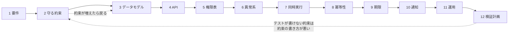
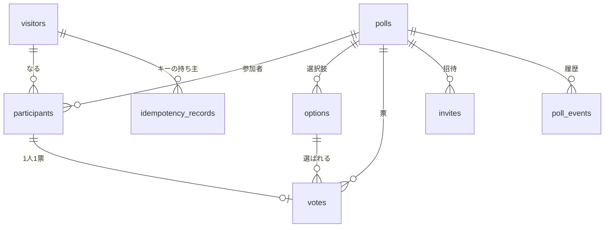
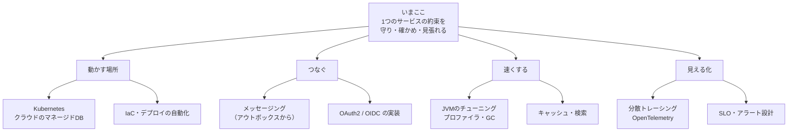

# 第48章 卒業制作：自分のサービスを設計する

<div class="goal-box" markdown>

この章でできるようになること

- 要件から検証計画までを、12項目のテンプレートで一人で書ける
- 守る約束（不変条件）を、「同時・再送・他人・時間・障害」の5方向から破ってみて、設計の穴を見つけられる
- 卒業チェックリスト30項目で、自分の到達段階（再現・説明・検証・変更）を判定できる
- 次に学ぶものの地図を見て、自分の次の一歩を選べる

</div>

この章は設計の章で、コードはほとんど出てきません。中心になるのは表と図で、最後に自分の題材で設計書を書くのが卒業制作です。

## 1. 問いかけ：白紙から、どこから書くか

第47章では、他人（AI）が書いたコードを読んでレビューしました。今度は逆に、何もない状態から、守るべき約束を決める側に回ります。

フロントエンドの経験があれば、新しい画面を作るとき、まず「状態は何か」「どんなイベントで変わるか」を紙に書くはずです。サーバーでは、それに加えて次の問いが要ります。

- 同時に2人が押したら、何が壊れるか
- 応答が消えて、同じ操作が再送されたら
- 他人が、IDを書き換えて呼んだら
- 期限の「ちょうどその瞬間」は
- 途中で相手（DB・外部API）が落ちたら

この章のテンプレートは、これらの問いを書く順番に並べたものです。QuickVote で埋めた見本を見てから、自分の題材で埋めます。

!!! tip "フロントエンドで例えると"
    React の設計で、状態の型（`type State = ...`）と、状態を変えるアクション（`reducer`）を先に決めるのと似ています。サーバーの「守る約束」は、reducer がどんな順番、どんな同時実行でも壊さない条件にあたります。違いは、サーバーの `reducer` が複数のプロセスから同時に呼ばれ、しかも状態が DB という共有の場所にあることです。

## 2. テンプレートの全体像

テンプレートは、約束を先に決め、実装の都合は後から考える順番で並べてあります。



| # | 項目 | 答える問い | 書くもの |
| --- | --- | --- | --- |
| 1 | 要件 | 誰が・何のために・何をするか。何をしないか | 箇条書き＋規模 |
| 2 | 守る約束 | 何がいつも成り立っていなければならないか | 約束の表（ID・文・破る操作） |
| 3 | データモデル | 約束を、どの表・制約・ロックで守るか | ER図＋「約束→仕組み」の表 |
| 4 | API | 外から何を呼べるか | 操作の表 |
| 5 | 権限表 | 誰が何をできるか。できないとき何を返すか | 役割×操作の表 |
| 6 | 異常系 | 失敗したとき、状態と応答はどうなるか | 異常→状態→応答の表 |
| 7 | 同時実行 | 何と何が競合し、どう守るか | 競合の組み合わせ表 |
| 8 | 冪等性 | 再送されたらどうなるか | 操作ごとの方式 |
| 9 | 期限 | 何が・いつ・誰の時計で・誰が消すか | 期限の表 |
| 10 | 通知 | 変化をどう届け、取りこぼしをどう直すか | イベント表 |
| 11 | 運用 | 何を記録し、何を記録せず、何を見張るか | ログ・指標・復旧 |
| 12 | 検証計画 | 約束ごとに、どのテストで確かめるか | 約束→テストの表 |

!!! note "用語：不変条件（守る約束）"
    処理の前後でいつも成り立っていなければならない条件です（[第0章](../part00/ch00-how-to-learn.md)）。「参加者は最大50人」のように、数えられる文で書きます。「安全に」「正しく」は約束になりません。

## 3. QuickVote でテンプレートを埋める

以下は QuickVote の見本で、内容はすべてリファレンス実装（`code/quickvote/`）と一致しています。書き方の手本なので、自分の設計書はもっと小さくてかまいません。

### 3.1 要件

| 項目 | QuickVote |
| --- | --- |
| 利用者 | 主催者（HOST）、参加者（MEMBER）。会員登録なし（匿名） |
| 目的 | 会議や飲み会で「今この場で決める」 |
| できること | 投票の作成／8文字の参加コードで参加／選択肢の追加（主催者が許可したとき）／1人1票（上書き可）／得票のリアルタイム表示／共同主催者の招待（一度限り）／締切／7日で削除 |
| 規模・同時利用 | 1投票あたり参加者50人・選択肢10件。会場の全員が同時に操作する |
| やらないこと | ログイン、参加者の除名、投票の一覧、決済、通知メール |

「やらないこと」を書いておくと、後で「なぜ無いのか」と聞かれたときの答えになります（実際、除名用の `revoked_at` 列はありますが、操作する API はありません）。

### 3.2 守る約束

| ID | 約束 | 破る操作（同時・再送・他人・時間・障害） |
| --- | --- | --- |
| P1 | 参加者は最大50人（主催者を含む） | 同時に49人目と50人目が参加／招待受諾と参加が同時 |
| P2 | 選択肢は最大10件 | 同時に追加 |
| P3 | 1人1票。再投票は上書き | 連打・複数タブ・同時送信 |
| P4 | 票は、同じ投票の参加者が、同じ投票の選択肢にだけ入れられる | 他人の投票の選択肢IDを指定 |
| P5 | 選択肢の追加は、再送しても二重に登録されない | 保存後に応答だけ消えて再送 |
| P6 | 招待は一度限り・24時間有効 | 2人が同時に受諾／時間切れ |
| P7 | 参加コードは総当たりで当てられない | 31種8文字（約8.5×10¹¹通り）を連打 |
| P8 | 締切後は、投票・選択肢追加・参加・招待受諾を拒否 | 締切の直前・ちょうど・直後 |
| P9 | 参加者でなければ、投票の存在も内容も分からない（404） | IDを書き換える（IDOR）、存在確認 |
| P10 | 得票率の表示は、合計がちょうど100.0% | 1/3ずつ |
| P11 | イベントは、欠けず・重複せず・順序どおり届く | 障害で切断、2台構成 |
| P12 | ログに本文・トークン・参加コードを残さない | DBエラーのメッセージ、URL |
| P13 | 作成から7日で物理削除される | ジョブの途中失敗、2台で同時に実行 |

!!! warning "約束の書き方のコツ"
    約束は数・状態・時刻で書きます（「50人以下」「締切後は拒否」）。曖昧な言葉ではテストにできません。右の列は必ず埋めます。破る操作が1つも思いつかない約束は、まだ理解できていない約束です。また、どの仕組みで守れるかは約束ごとに違います（たとえば P1 は「親行ロック」で守り、DB 制約では守れません）。

### 3.3 データモデル



図よりも重要なのは、約束をどの仕組みで守るかを示す次の表です。

| 約束 | 守る仕組み | 種類 |
| --- | --- | --- |
| P1・P2 | `polls` 行を `FOR UPDATE` でロック → 再カウント → 挿入。すべての更新経路で同じ規則 | ロック（複数行にまたがる条件。DB制約では守れない） |
| P3 | `UNIQUE (poll_id, participant_id)` ＋ `INSERT ... ON CONFLICT DO UPDATE` | 制約 |
| P4 | 複合外部キー `votes (poll_id, option_id) → options (poll_id, id)` | 制約 |
| P5 | `idempotency_records` の主キー `(visitor_id, idem_key)`。業務更新と同じトランザクション | 制約＋トランザクション |
| P6 | `UPDATE invites ... WHERE used_at IS NULL AND expires_at > ?` の更新件数 | 条件付き更新 |
| P7 | `join_code` の `UNIQUE` と形式の `CHECK`。回数制限（アプリ） | 制約＋アプリ |
| P11 | `poll_events` の主キー `(poll_id, seq)`。採番は `polls.last_event_seq` の更新（行ロック下） | 制約＋ロック |
| P13 | `delete_after` の索引と、`@Scheduled` の削除（`pg_try_advisory_lock`） | ジョブ |

!!! note "アプリのifは前線、制約は最終防衛線"
    P8（締切）や P9（認可）のように DB の制約では表せない約束は、アプリで守ります。DB で表せるものは必ず DB にも書いておくと、アプリにバグがあっても DB が最後に止めてくれます（[第18章](../part03/ch18-data-modeling.md)）。

### 3.4 API

| 操作 | メソッド・パス | 権限 | 成功 |
| --- | --- | --- | --- |
| 投票を作る | `POST /api/polls` | 誰でも（訪問者Cookieを発行） | 201 |
| 参加する | `POST /api/join` `{code}` | 誰でも（回数制限） | 200 |
| 詳細を見る | `GET /api/polls/{pollId}` | 参加者 | 200 |
| 選択肢を追加 | `POST /api/polls/{pollId}/options`（`Idempotency-Key` 必須） | HOST、または許可時のMEMBER | 201 |
| 投票する | `PUT /api/polls/{pollId}/my-vote` | 参加者・締切前 | 200 |
| 締め切る | `POST /api/polls/{pollId}/close` | HOST | 204 |
| 削除する | `DELETE /api/polls/{pollId}` | HOST | 204 |
| 招待を発行 | `POST /api/polls/{pollId}/invites` | HOST（回数制限） | 201 |
| 招待を受ける | `POST /api/invites/{token}/accept` | 誰でも（一度限り） | 200 |
| 購読する | `GET /api/polls/{pollId}/events`（SSE） | 参加者 | 200 |

メソッドの選び方にも約束が反映されています。投票は `PUT` で、「自分の票はこの選択肢」と状態を指定するので、本質的に冪等です。選択肢の追加は新しいものを作るので `POST` で、冪等にするには鍵が要ります。招待の受諾が `GET` ではなく `POST` なのは、リンクの先読みで消費されないようにするためです。

### 3.5 権限表

| 操作 | 非参加者 | MEMBER | HOST |
| --- | --- | --- | --- |
| 詳細・購読 | 404 | 200 | 200 |
| 選択肢追加 | 404 | 許可時のみ 201（不許可は 403） | 201 |
| 投票 | 404 | 200（締切後 409） | 200（締切後 409） |
| 締切・削除・招待発行 | 404 | 403 | 成功 |

権限表は、行の数だけテストを書きます（`PermissionMatrixIT` は、この表の全部の行を叩いています）。「存在しない投票」と「参加していない投票」は同じ404で、`code` も `detail` も同一です。

### 3.6 異常系

| 起きること | 状態 | 応答 |
| --- | --- | --- |
| 参加者が上限 | 何も変えない | 409 `POLL_FULL` |
| 締切後の操作 | 何も変えない（招待は未消費のまま） | 409 `POLL_CLOSED` |
| 同じキーで別内容 | 何も変えない | 422 `IDEMPOTENCY_KEY_REUSED` |
| 招待が無効・期限切れ・使用済み | 何も変えない | 404 `INVITE_INVALID`（理由を区別しない） |
| 試行回数の超過 | 何も変えない | 429 ＋ `Retry-After` |
| 入力が不正 | 何も変えない | 400 `VALIDATION_FAILED`（入力値は応答に含めない） |
| 想定外の例外 | トランザクションごと取り消し | 500 `INTERNAL_ERROR`（スタックは出さない） |
| DBが止まる | — | readiness が 503（livenessは UP のまま） |
| SSEが切れる | — | ブラウザが再接続し `Last-Event-ID` 以降を再送。履歴が使えなければ `RESYNC` |

この表に共通するルールは、失敗した試行は何も残さないことです（業務エラーはトランザクションごと取り消します）。

### 3.7 同時実行

| 競合する組み合わせ | 守る方式 |
| --- | --- |
| 参加 × 参加、参加 × 招待受諾 | 親行ロック → 再カウント（P1） |
| 選択肢追加 × 選択肢追加 | 同上（P2） |
| 同一人物の投票 × 投票 | UNIQUE ＋ `ON CONFLICT`（ロック不要。P3） |
| 招待受諾 × 招待受諾 | 条件付き `UPDATE` の更新件数が1の人だけ成功（P6） |
| 締切 × 投票 | 親行をロックしたあとで時刻を読む（P8） |
| 冪等性の削除ジョブ × 再送 | `FOR SHARE` で読み、消えていたら先取りからやり直す |
| ジョブ × ジョブ（2台） | `pg_try_advisory_lock`。取れなければスキップ |

!!! danger "ロックの順序も設計に書く"
    ロックを複数取る操作は、順序を決めないとデッドロックします。QuickVote は常に「冪等性の行 → `polls` 行」の順です（[第26章](../part04/ch26-concurrency-testing.md)）。

### 3.8 冪等性

| 操作 | 方式 |
| --- | --- |
| 選択肢の追加 | `Idempotency-Key` ＋ 記録（訪問者×キー）。同じ入力なら保存済みの応答を返す（`Idempotent-Replayed: true`）。保持24時間 |
| 投票（`PUT`） | 本質的に冪等。同じ選択肢への再投票は0件更新で、イベントを出さない |
| 参加 | 同じ訪問者の再参加は成功（何も変えない） |
| 締切 | 二重に締めてもイベントは1回 |
| 投票の作成 | 割り切り：キーなし。再送すると別の投票ができる（回数制限で量を抑える） |

「割り切り」も設計書に書きます。やらない理由が書かれていれば、レビューで議論できるからです。

### 3.9 期限

| 何が | 期間 | 判定する場所 | 誰が消すか |
| --- | --- | --- | --- |
| 投票の締切 | 5〜10080分（作成時にサーバーが `Clock` から計算） | API（`now >= closes_at` なら拒否） | — |
| 投票の物理削除 | 作成から7日 | — | `@Scheduled`（件数を区切る） |
| 招待 | 24時間 | 受諾時の条件付き `UPDATE` | 定期削除 |
| 冪等性の記録 | 24時間 | 再送時（期限切れなら新しい操作） | 再利用時と定期削除 |
| 訪問者 | 60日使われない | — | 定期削除 |

時刻にはサーバーの `Clock` だけを使い、クライアントの時計には依存しません。「5分後」をクライアントが絶対時刻で送ると、通信時間のぶん短くなって拒否される、という事故が実際に起きました（第47章の#14）。

### 3.10 通知

| 項目 | 設計 |
| --- | --- |
| イベント | `PARTICIPANT_JOINED`・`OPTION_ADDED`・`VOTE_CAST`・`POLL_CLOSED`・`RESYNC` |
| 順序 | 投票ごとの連番 `seq`（行ロック下で採番。採番順＝コミット順） |
| 保存 | 業務更新と同じトランザクションで `poll_events` に保存。`NOTIFY` はコミット時に配送される |
| 取りこぼし | `Last-Event-ID` 以降を履歴から再送。クライアントは再接続のたびに詳細を取得し直す |
| 複数台 | `LISTEN/NOTIFY` で他のインスタンスにも届ける。通知の中身は信用せず、DBを読み直す |

### 3.11 運用

| 項目 | 設計 |
| --- | --- |
| ログに出す | メソッド・ルートのパターン・ステータス・所要時間・相関ID、例外の型・SQLSTATE（許可した項目だけ） |
| ログに出さない | 選択肢・タイトル・参加コード・トークン・Cookie・`Idempotency-Key`・本文・URL全体・DBエラーのメッセージ |
| 指標 | DBコネクションプール、HTTPの件数と所要時間、readiness（DB疎通を含む）。本番は管理ポート9090で内部のみ |
| 見張る | readiness の失敗、5xx の増加、コネクションプールの待ち、削除ジョブの失敗 |
| 復旧 | DBのバックアップから復元する手順を、公開前に一度やってみる（[第46章](../part09/ch46-release.md)） |

### 3.12 検証計画

| 約束 | テスト | 赤くする方法 |
| --- | --- | --- |
| P1 | 49人の状態から20スレッドが同時に参加 → 成功ちょうど1件（`ConcurrencyIT`） | 親行ロックを外す |
| P3 | 同一人物の20並列投票 → 1行。ロックなしでも成り立つことも確認 | UNIQUE を外す |
| P4 | 別の投票の選択肢への投票が制約で拒否される（`SchemaConstraintIT`） | 複合外部キーを単純な外部キーに戻す |
| P5 | 同じキー10並列 → 1件のみ、全員同じ応答。キー再利用で422（`IdempotencyIT`） | 記録をトランザクションの外に出す |
| P6 | 同じ招待を10人が同時受諾 → 成功1件 | 条件付き `UPDATE` を `SELECT` → `UPDATE` に |
| P8 | `Clock` を進め、直前は成功・ちょうどから拒否（`DeadlineIT`） | 判定を `>` にする |
| P9 | 権限表の全行（`PermissionMatrixIT`） | 判定を1か所外す |
| P12 | ログを捕まえて秘密の文字列を探す。実際のCHECK違反も起こす（`LoggingIT`） | `log.error("..", ex)` に戻す |
| P13 | 7日後に消える、件数を区切る、2台目はスキップ（`CleanupIT`） | advisory lock を外す |

右端の「赤くする方法」が書けるテストだけが、約束を守っています。赤くならないテストは何も確かめていません（第47章の152件）。

## 4. あなたの題材で埋める

ここからが卒業制作です。自分の題材で12項目を埋めます。

### 4.1 題材の選び方

QuickVote と同じ論点が自然に出てくる題材を選んでください。次のうち3つ以上に当てはまれば十分です。

- [ ] 共有の単位（部屋・グループ・イベントなど）があり、参加の認可が要る
- [ ] 上限がある（定員・件数・容量）
- [ ] 再送されて困る操作がある（登録・予約・注文）
- [ ] 期限がある（締切・有効期限・自動削除）
- [ ] 一度限りの権利やリンクがある
- [ ] 誰かの変化を、他の人にすぐ見せたい

例：定員つきのイベント出欠、時間枠の予約受付、順番待ちの受付番号、期限つきの共有メモ。ログイン機能は要りません（匿名セッションで十分に設計できます）。

### 4.2 空のテンプレート

そのままコピーして、埋めてください。

```markdown
# <サービス名> 設計書

## 1. 要件
- 利用者／目的:
- できること:
- やらないこと（とその理由）:
- 規模・同時利用（最大人数、件数、同時に操作する人数）:

## 2. 守る約束
| ID | 約束（数・状態・時刻で書く） | 破る操作（同時／再送／他人／時間／障害） |
| --- | --- | --- |

## 3. データモデル
- ER図:
- 約束を守る仕組み（制約／ロック／条件付き更新／トランザクション）:
| 約束 | 守る仕組み | 種類 |
| --- | --- | --- |

## 4. API
| 操作 | メソッド・パス | 権限 | 成功 |
| --- | --- | --- | --- |

## 5. 権限表
| 操作 | 非参加者 | 一般参加者 | 管理者 |
| --- | --- | --- | --- |

## 6. 異常系
| 起きること | 状態 | 応答 |
| --- | --- | --- |

## 7. 同時実行
| 競合する組み合わせ | 守る方式 |
| --- | --- |

## 8. 冪等性
| 操作 | 方式（または割り切りとその理由） |
| --- | --- |

## 9. 期限
| 何が | 期間 | 判定する場所 | 誰が消すか |
| --- | --- | --- | --- |

## 10. 通知
- イベントの種類／順序／取りこぼしの直し方／複数台のとき:

## 11. 運用
- ログに出す／出さない:
- 指標・見張るもの:
- 復旧の手順:

## 12. 検証計画
| 約束 | テスト | 赤くする方法 |
| --- | --- | --- |
```

### 4.3 書く順番のコツ

1. 1と2を最初の1時間で書く。残りは2が決まってから書く
2. 2の「破る操作」を、5方向（同時・再送・他人・時間・障害）のすべてで考える。1つの約束で5つ書けなくてよいが、約束全体では5方向が1回ずつは出るはず
3. 3で、各約束に守る仕組みを1つ以上割り当てる。割り当てられない約束は、書き直す
4. 5の権限表は、4の API の全行について書く。API 一覧にあって権限表にない行は、認可の穴
5. 12を書きながら2に戻る。テストが書けない約束は、約束の書き方が悪い

### 4.4 自分で設計をレビューする：10の質問

書き終えたら、第47章の5周の読み方を自分の設計書に使います。

| # | 質問 |
| --- | --- |
| 1 | 約束は、数・状態・時刻で書かれているか（「安全に」になっていないか） |
| 2 | すべての約束に、破る操作が書かれているか |
| 3 | すべての約束に、守る仕組みが1つ決まっているか。DBで表せるものは、DBにも書いたか |
| 4 | API一覧の全行が、権限表の行になっているか |
| 5 | 状態を変えるすべての経路が、同じ規則（同じロック・同じ判定）に従うか |
| 6 | 再送されうる操作に、冪等性の方式、または割り切りの理由があるか |
| 7 | 期限は、「誰の時計で、どこで判定するか」まで書けているか |
| 8 | 通知を取りこぼしたとき、どうやって回復するか書いたか |
| 9 | ログに出さないものが、名前つきで書かれているか |
| 10 | すべての約束に、「赤くする方法」つきのテストがあるか |

!!! example "卒業制作の提出物（自分用）"
    1. 12項目を埋めた設計書（Markdown、A4で5〜8ページ程度）
    2. 約束のうち最も壊れやすい3つについて、反証テストの骨子（テスト名と、何を並べて何を確かめるかの3行）
    3. 上の10の質問への自己採点（○／△／×と、△×の直し方）

    実装は、卒業後の自由です。ただし、この設計書があれば、AI に実装を頼むときに約束とテストを先に渡せます（[第47章](ch47-ai-review.md)のレビューも、この約束を基準にできます）。

## 5. 卒業チェックリスト：30項目

[第0章](../part00/ch00-how-to-learn.md)の4段階で、自分の位置を確かめます。

| 段階 | 状態 | 確認の仕方 |
| --- | --- | --- |
| ① 再現できる | 教材どおりの手順で、同じ結果が出せる | 実行して、出力が一致する |
| ② 説明できる | なぜそうなるかを、他人に説明できる | 白紙に自分の言葉で書く |
| ③ 検証できる | 条件を変えて、保証が保たれるか調べられる | 反例を作り、テストで確かめる |
| ④ 変更できる | 見たことのない仕様変更に、保証を保ったまま対応できる | 応用問題・卒業制作 |

各項目の太字は、卒業までに到達したい段階です。ほとんどは③で、同時実行・冪等性・認可・レビュー・設計の5つの領域（6項目）は④を目指します。説明できない項目は白紙に書いてみて、書けなければリンク先の章へ戻ります。

### 基礎（第1〜2部）

- [ ] **③** 共有される可変状態（Beanのフィールド・`static`）を指摘し、ローカル変数・不変オブジェクト・`Atomic*` で直せる（[第9章](../part01/ch09-threads.md)・[第11章](../part02/ch11-di-container.md)）
- [ ] **②** リクエストが Filter → DispatcherServlet → Controller → Service → Repository を通る流れを、図に描いて説明できる（[第10章](../part02/ch10-spring-boot.md)・[第12章](../part02/ch12-request-journey.md)）
- [ ] **③** `record` のDTOでAPI契約を書き、Entityを返す・`Map`で受ける設計を指摘できる。JSONの欠落・null・日時の扱いを確かめられる（[第13章](../part02/ch13-api-contract.md)）
- [ ] **③** 入力検証・業務ルール・DB制約の3層を使い分け、ProblemDetailでエラーを返し、`MockMvcTester` で正常・異常・境界を確かめられる（[第14章](../part02/ch14-validation-errors.md)・[第16章](../part02/ch16-api-testing.md)）
- [ ] **③** 設定を型付きで検証し、秘密をGitに入れず、不正な値では起動時に落とせる（[第15章](../part02/ch15-configuration.md)）

### データベース（第3部）

- [ ] **③** Flywayで新しい `V` を足し、適用済みのファイルを書き換えない理由を説明できる（[第17章](../part03/ch17-postgres-flyway.md)）
- [ ] **③** 約束を、単一行で守れる条件（UNIQUE・CHECK・FK）と、複数行にまたがる条件に分けて、守る仕組みを選べる（[第18章](../part03/ch18-data-modeling.md)）
- [ ] **③** JdbcClientで、バインド変数・更新件数・`DuplicateKeyException` を使え、SQLインジェクションを再現して防げる（[第19章](../part03/ch19-jdbcclient.md)）
- [ ] **③** `EXPLAIN ANALYZE` を読み、索引の列順とページング方式（offset／keyset）を選べる（[第20章](../part03/ch20-query-index.md)）
- [ ] **③** Testcontainersの実PostgreSQLで、制約や `ON CONFLICT` を含むテストを書ける（[第21章](../part03/ch21-testcontainers.md)）

### トランザクションと同時実行（第4部）

- [ ] **③** `@Transactional` が効かない形（自己呼び出し・検査例外・握りつぶし）を再現し、ログでBEGIN/COMMITを確認できる（[第22章](../part04/ch22-transactions.md)・[第23章](../part04/ch23-transactional-proxy.md)）
- [ ] **③** コネクションプールの枯渇を再現し、トランザクション中の外部通信を設計から排除できる（[第24章](../part04/ch24-connection-pool.md)）
- [ ] **④** 「残り1枠に2人」を再現し、親行ロックで直し、すべての更新経路に同じ規則を適用できる（[第25章](../part04/ch25-locking.md)）
- [ ] **④** 楽観ロック・条件付きUPDATE・`ON CONFLICT` を使い分け、`CountDownLatch` で狙った競合のテストを書ける（[第26章](../part04/ch26-concurrency-testing.md)）

### 再送・期限・定期処理（第5部）

- [ ] **④** 応答が消える再送を再現し、冪等性キー（スコープ・同じキー別内容・同時・同一トランザクション・保持期限）を設計できる（[第27章](../part05/ch27-idempotency.md)）
- [ ] **③** `Clock` を注入して締切の境界（直前・ちょうど・直後）をテストし、「拒否」と「物理削除」を分けて設計できる（[第28章](../part05/ch28-time-expiry.md)）
- [ ] **③** 定期処理を、件数を区切り・再実行でき・2台で同時に走らない形で書ける（[第29章](../part05/ch29-scheduling.md)）

### 認可とブラウザ境界（第6部）

- [ ] **④** 権限表を書き、全操作をテストで総当たりして、IDORと存在の漏れを防げる（[第30章](../part06/ch30-authz-design.md)）
- [ ] **②** Spring Securityのフィルタ連鎖を図で説明し、`SecurityFilterChain` の `@Bean` を読み書きできる（[第31章](../part06/ch31-spring-security.md)）
- [ ] **③** 匿名セッション（乱数・DBにはハッシュ・Cookie属性）を設計・実装でき、Cookieを消すと権限を失うことを仕様として説明できる（[第32章](../part06/ch32-anonymous-session.md)）
- [ ] **③** 一度限りの招待を原子的に実装し、参加コードの探索空間を計算して、複数軸のレート制限と複数台での限界を説明できる（[第33章](../part06/ch33-invites-brute-force.md)・[第35章](../part06/ch35-rate-limiting.md)）
- [ ] **③** CSRF・CORS・SameSiteの役割を区別し、Cookie認証のAPIに必要な設定を理由つきで言える（[第34章](../part06/ch34-browser-boundary.md)）

### リアルタイム通知（第7部）

- [ ] **③** `SseEmitter` の後始末・認可・ハートビートを書け、遅い購読者が全体に及ぼす影響を説明できる（[第36章](../part07/ch36-sse.md)）
- [ ] **③** イベント履歴と `Last-Event-ID` で取りこぼしを防ぎ、2台構成で「隣のサーバーに届かない」問題を説明できる（[第37章](../part07/ch37-event-history.md)・[第38章](../part07/ch38-multi-instance.md)）

### JPA（第8部）

- [ ] **③** 永続コンテキスト・N+1・OSIV を説明し、SQL本数を数えるテストで検出できる。JPAとSQLの使い分けを理由つきで選べる（[第39章](../part08/ch39-jpa-basics.md)〜[第41章](../part08/ch41-sql-vs-jpa.md)）

### 運用（第9部）

- [ ] **③** 許可した項目だけを出す構造化ログと相関IDで、障害を後から追える設計にできる（[第43章](../part09/ch43-logging.md)）
- [ ] **③** ヘルスチェック（readiness／liveness）・指標・タイムアウト・graceful shutdown を設計し、異常の兆候を見つける手順を説明できる（[第44章](../part09/ch44-metrics.md)・[第45章](../part09/ch45-performance.md)）
- [ ] **②** Docker化、稼働中に壊さないマイグレーション、バックアップと復元、公開前チェックリストでリリースと復旧を説明できる（[第42章](../part09/ch42-docker.md)・[第46章](../part09/ch46-release.md)）

### AIとの協働・設計（第10部）

- [ ] **④** AIが生成したコードを、約束→入口→状態を変える所→異常系→反証テストの順にレビューし、欠陥を赤いテストで示せる（[第47章](ch47-ai-review.md)）
- [ ] **④** 自分の題材で、要件から検証計画までを一人で設計し、10の質問で自己レビューできる（本章）

!!! tip "判定の目安"
    - 30項目中、④の6項目を含めて25項目以上に ✅ が付けば卒業です
    - 20〜24項目：同時実行と認可の項目（④）が付いているかを先に確かめる。付いていなければ、第25・27・30章の応用問題をやり直す
    - 19項目以下：該当部の「部のチェックリスト」と統合課題に戻る

## 6. 教材全体の振り返り

最初の合格文を、もう一度読みます。

> データ・権限・期限・同時実行について守る条件を定義し、Java/Springで実装し、再送や障害を含むテストで確かめ、運用時に異常を発見して復旧する方法を説明できる。AIの生成物も同じ基準でレビューできる。

各部は、この文の別々の部分を支えていました。

| 部 | QuickVote の状態 | 持ち帰る考え方 |
| --- | --- | --- |
| 0 はじめに | 完成形を知る | サーバーは約束を守るもの。間違いは画面に出ない |
| 1 Javaを読む | 部品（状態・得票率・時刻）をJavaで書く | 型は名前で決まる。`==`・`double`・`LocalDateTime` は事故の元。サーバーは同時に動く |
| 2 Spring Boot | メモリ上で動く | Beanは全員で共有される。境界（JSON・入力・エラー）で守る |
| 3 PostgreSQL | DBに保存。実DBでテスト | アプリのifは前線、制約は最終防衛線。H2で通っても安心しない |
| 4 同時実行 | 人数・件数・1人1票が同時でも守られる | 確認してから更新は壊れる。ロックと制約で1操作にする。「100回動いた」は根拠にならない |
| 5 再送・期限 | 再送で二重登録しない。締切と削除 | 応答は消える。冪等性キー。時刻は `Clock`、拒否と削除は分ける |
| 6 認可 | 他人に触られても壊れない | 認証・識別・認可は別。404で存在を漏らさない。CORSはサーバーを守らない |
| 7 リアルタイム | 得票が動く。再接続で補完。2台でも届く | 履歴を同じトランザクションに。メモリの名簿は台数が増えると届かない |
| 8 JPA | （比較用の別プロジェクト） | 肩代わりしてくれるものと、隠すものをSQLを数えて知る |
| 9 運用 | 公開できる状態 | ログは許可した項目だけ。readinessは依存先を見る。稼働中に壊さない |
| 10 卒業 | AIのコードをレビューし、自分の設計を書く | 約束を決めるのは人間。反証テストで確かめる |

QuickVote は、最後に258件のテスト（単体113件、統合145件）で守られました。一方、その前の152件のテストは、18件の穴を見逃していました。この教材の最後の教訓は、テストの件数ではなく、どの方向を確かめているかにあります。

!!! question "予測カード：自己診断"
    次の3つに、白紙に書いて答えてください。1問2分以内で書けなければ、該当の章へ戻ります。

    1. 参加者が50人まで、という約束を、DB の制約だけで守れないのはなぜか。何で守るか（[第18章](../part03/ch18-data-modeling.md)・[第25章](../part04/ch25-locking.md)）
    2. 応答が消えて再送されたとき、二重登録を防ぐために何と何を同じトランザクションに入れるか（[第27章](../part05/ch27-idempotency.md)）
    3. CORS を正しく設定しても、他のサイトからの `POST` が成功してしまうことがある。それはなぜで、何で防ぐか（[第34章](../part06/ch34-browser-boundary.md)）

## 7. 次に学ぶもの：地図

この教材が扱うのは、1つのサービスを1つのデータベースの上で正しく作るところまでです。ここから先は枝分かれします。



| テーマ | この教材のどこからつながるか | 最初の一歩 |
| --- | --- | --- |
| Kubernetes・クラウドのマネージドサービス | 第42章（Docker）、第44章（readiness／liveness）、第45章（graceful shutdown） | 第42章のイメージを、ローカルのKubernetes（kind など）に載せ、プローブと終了シグナルの動きを観察する |
| メッセージング（Kafka・RabbitMQなど） | 第24章（トランザクション中に外部通信しない）、第27章（冪等性）、第38章（LISTEN/NOTIFY） | 第47章の演習1の「通知」を、アウトボックス表（業務更新と同じトランザクションで書いて、別プロセスが送る）に作り替える |
| OAuth2 / OIDC の実装 | 第30章（認証・識別・認可）、[付録：ログイン型認証の概観](../appendix/login-auth.md) | 付録を読み、QuickVote の訪問者の代わりに、外部IdPのIDを「利用主体」にする設計を書く（権限表は変わらない） |
| 性能チューニング | 第45章（p95/p99、負荷試験、スレッドダンプ） | 負荷試験の結果を、JFR（JDK Flight Recorder）やプロファイラで読み、遅い1点を探す |
| オブザーバビリティ（トレース） | 第43章（相関ID）、第44章（メトリクス） | 相関IDを、OpenTelemetryのトレースIDに置き換えて、1リクエストの旅を可視化する |
| キャッシュ・検索 | 第20章（索引）、第38章（複数台での状態共有） | まず索引とクエリで足りないことを`EXPLAIN`で示してから、Redis などを足す。キャッシュの無効化も「約束」として書く |
| 分散システム（結果整合・Saga） | 第26章（競合）、第27章（冪等性） | 2つのサービスにまたがる操作の「途中失敗」を、第48章のテンプレートの異常系に書いてみる |
| セキュリティの深掘り | 第30〜35章 | OWASP ASVS のチェック項目を、自分の設計書の「守る約束」に対応づける |
| テスト戦略 | 第16・21・26章 | 変異テスト（mutation testing）で、「赤くする方法」が本当に赤くなるかを機械で確かめる |
| Kotlin・Gradle | [付録：Gradle 対訳](../appendix/gradle.md) | 付録の対訳で、pom.xml を `build.gradle.kts` に書き換える |

!!! warning "次に学ぶものの選び方"
    新しい技術を足す前に、自分の設計書の「割り切り」の欄を見ます。「複数台ではレート制限が緩む」「作成は再送で2つできる」のように書いた割り切りのうち、本当に困るものが、次に学ぶものです。技術から選ぶと、使わない機能を足してしまいます。

---

## まとめ：3点セット

!!! abstract "この章の3点セット"
    **① 一言で言うと**
    サービスの設計とは、守る約束（不変条件）を数・状態・時刻で書き、各約束を破る操作（同時・再送・他人・時間・障害）を考え、守る仕組み（制約・ロック・条件付き更新・トランザクション）とテストを対応づけること。テストが書けない約束は、書き方が悪い。

    **② 現場でこう聞かれる**
    「この機能の設計で、同時実行と再送はどう考えましたか？」
    → まず守る約束を書き出し、各約束について、同時に2人が来た場合と、応答が消えて再送された場合を考えた。複数行にまたがる条件は親行のロック、1人1票のような単一の条件は制約、再送には冪等性キーを同じトランザクションで記録した。それぞれ、赤くなるテストを用意してある。

    **③ 自分のサービスならどこに当たるか**
    第4節のテンプレートを、自分の題材で埋める。まず1「要件」と2「守る約束」を、最初の1時間で書く。

## 演習

??? question "確認問題1：約束の書き換え"
    次の「約束」は、テストにできません。数・状態・時刻を使って書き直してください。(a) 「予約は安全に処理される」 (b) 「古いデータは適切に消える」 (c) 「他人の予約は見られない」

??? success "解答"
    例：(a) 「同じ時間枠の予約は1件だけ成立する。同時に2人が申し込んでも、成功は1人だけ」 (b) 「作成から30日後の0時（UTC）を過ぎた予約は、その後1時間以内に物理削除される」 (c) 「予約の作成者・同席者以外が予約IDを指定すると、存在しない場合と同じ404が返る」。いずれも、反例を作れる文になっています。

??? question "確認問題2：守る仕組みの選択"
    「1つの時間枠に予約できるのは最大3人」を守る仕組みを、(a) DB制約だけ (b) 親行ロックと再カウント (c) 枠の行に `booked` 列を持ち、条件付き `UPDATE` で加算 のそれぞれについて、守れるか・弱点は何かを答えてください。

??? success "解答"
    (a) 守れない。複数行にまたがる条件（3人以下）は、単一行の制約では表せない（`UNIQUE`・`CHECK` は行ごと）。(b) 守れる。すべての更新経路が、同じ順序（親行ロック→再カウント→挿入）に従う限り。弱点は、経路が1つでも抜けると破れること、枠ごとの直列化のコスト。(c) 守れる。`UPDATE slots SET booked = booked + 1 WHERE id = ? AND booked < 3` の更新件数が1の人だけが成功する。`CHECK (booked <= 3)` を付けると、DBも最終防衛線になる。弱点は、キャンセルで `booked` を減らす経路でも同じ規則を守る必要があること、列と実際の行数がずれうること。

??? question "応用：QuickVote に『参加者の除名』を足す"
    主催者が参加者を除名できる機能を足すとします（`participants.revoked_at` に時刻を入れる）。テンプレートの12項目のうち、少なくとも5項目で何が変わりますか。

??? success "解答"
    例：項目2「守る約束」に「除名された人は、除名後に投票・追加・購読できない」「除名しても、すでに入れた票の扱いを決める（残す／消す）」を追加。項目4「API」に `DELETE /api/polls/{id}/participants/{pid}`、項目5「権限表」にHOSTのみの行を追加（MEMBERは403、非参加者は404）。項目7「同時実行」：除名と投票が同時に来たとき（親行ロックの内側で除名済みかを判定する）。項目8「冪等性」：二重に除名しても結果が同じ。項目10「通知」：除名イベントの種類を足し、購読中の接続を切る。項目1「要件」の「やらないこと」から除名を消す。項目12「検証計画」：除名直後の投票が拒否されるテスト（赤くする方法：判定を外す）。人数の上限（P1）の数え方（除名者を数えるか）も、約束の書き直しが必要です。

??? question "説明問題：現場でこう聞かれる"
    「この設計書で、一番時間をかけた部分はどこですか？ なぜですか？」200字程度で答えてください。

??? success "解答"
    例：「守る約束」と、それを破る操作の洗い出しに一番時間をかけました。実装の方式は約束が決まれば選べますが、約束が曖昧だと、ロックも制約もテストも決まりません。特に「同時」と「再送」の2方向で、どの操作同士が競合するかを表にしたことで、親行ロックが必要な経路と、制約で足りる経路を分けられました。最後に、各約束を赤くする方法まで書けたかで、設計の完成度を確かめました。

## 卒業おめでとうございます

ここまで読み、動かし、壊して、確かめてきたあなたは、AI が書いた Spring のコードを約束の側から読めます。次は、あなたの題材の設計書から始めてください。

[第10部の扉](index.md)に、第10部のチェックリストがあります。
