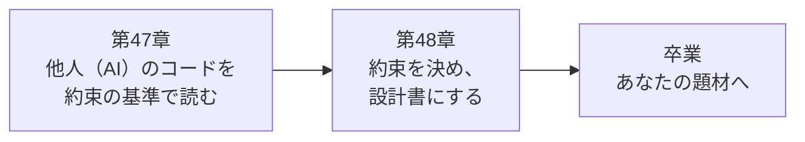

# 第10部 卒業

<!-- part-intro:start -->
<div class="video-card">
  <video controls preload="metadata" poster="../assets/videos/part10-intro.jpg">
    <source src="../assets/videos/part10-intro.mp4" type="video/mp4">
  </video>
  <p class="video-caption">▶ 第10部でやること（約1分）</p>
  <p class="video-credit">音声：VOICEVOX:冥鳴ひまり</p>
</div>

??? note "字幕全文"
    第10部は卒業です。
    確かめる側、決める側に回ります。
    AIが書いたコードはテストが全部通ることがあります。
    QuickVoteも、152件のテストが通っていました。
    それでもレビューで18件の穴が見つかりました。
    テストが通っただけでは、約束が守られているとは言えません。
    第47章はAIと組むレビュー術。
    約束の基準でコードを読みます。
    古い世代の書き方も、grepとコンパイルとテストで見抜きます。
    欠陥入りのコード3本は、赤くなるテストで示します。
    第48章は卒業制作。
    自分の題材を、要件から検証計画まで12項目で設計します。
    最後に30項目のチェックリストで、到達段階を確かめます。
    次に学ぶものを選ぶための地図もあります。
    この部では新しい技術は出てきません。
    ここまでの道具を組み合わせて使います。
    この部が終わると、AIの生成物を同じ基準でレビューできます。
    自分のサービスの設計書を一人で書けます。
    コードを書く側から、約束を決める側へ。
<!-- part-intro:end -->

最後の部では、コードを書く側から、確かめる側・決める側に回ります。AIが書いたコードを約束の基準でレビューし、自分のサービスの設計書を一人で書きます。新しい技術は出てきません。ここまでに作った道具を組み合わせて使います。

## この部でできるようになること

- テストが全部通っていたコードに、なぜ穴が残るのかを、QuickVote で実際に見つかった18件で説明できる
- 32項目のチェックリストで、AIが書いたSpringのコードを、観点ごとにレビューできる
- 古い世代の書き方（Boot 3以前・Jackson 2など）を、grep・コンパイル・テストの3段階で見抜ける
- 欠陥入りのコードを読み、何が起きるか・どう見つけるか・どう直すかを、赤くなるテストで示せる
- 守る約束（不変条件）から始めて、要件から検証計画までを12項目の設計書にできる
- 卒業チェックリスト30項目で、自分の到達段階を判定し、次に学ぶものを選べる

## アプリの到達状態

QuickVote は、第9部で公開できる状態になっています。この部では、アプリを変更しません。

| 項目 | 状態 |
| --- | --- |
| テスト | 258件（単体113件＋統合145件）。最初の版は152件で、シニアレビューの18件を反映して増えた |
| 守っている約束 | 人数50人・選択肢10件・1人1票・再送・締切・一度限りの招待・認可・イベントの欠落なし・ログの秘密など |
| この部の主役 | QuickVote ではなく、自分の題材の設計書と、レビュー演習用の欠陥入りコード3本 |

## 各章

<div class="grid cards" markdown>

-   :material-magnify-scan: **[第47章 AIと組むレビュー術](ch47-ai-review.md)**

    ---

    152件のテストが通っていたのに見つかった18件。レビュー観点32項目。欠陥入りコード3本を読んで、赤いテストで示します。

-   :material-clipboard-check-outline: **[第48章 卒業制作：自分のサービスを設計する](ch48-capstone.md)**

    ---

    要件から検証計画までの12項目テンプレート。QuickVote の記入例。卒業チェックリスト30項目と、次に学ぶものの地図。

</div>

## 第10部の流れ



第47章では、約束が書かれていないコードはレビューできないことを体験します。第48章では、その約束を先に書く側に回ります。第47章の5周の読み方は、第48章で自分の設計書を自己レビューするときにも使います。

## 実験コードの置き場

```text
code/labs/ch47-review/
├── review1-transaction/   演習1: 同時実行・トランザクション（要 Docker）
├── review2-boundary/      演習2: 認可・ブラウザ境界・ログ
├── review3-api-sse/       演習3: API契約・エラー応答・SSE・共有状態（要 Docker）
├── review-grep.sh         grep で拾える観点を一括確認するスクリプト
└── README.md
    （各プロジェクトは bad/ = 欠陥入り、fixed/ = 修正版、src/test = 約束のテスト）
```

```bash
cd code/labs/ch47-review
./mvnw test                                        # 修正版に対するテスト（すべて緑）
./mvnw test -Dreview.excluded=none -Dgroups=red    # 欠陥入りに対するテスト（赤になるのが正しい）
```

Windows では `.\mvnw.cmd` に読み替えます。レビューが終わるまで `fixed/` は開かないでください。

## 第10部のチェックリスト

第48章を終えたら、次の項目を確かめてください。説明できない項目は、白紙に自分の言葉で書いてみて、書けなければ該当章へ戻ります。目安は「③ 検証できる」です。卒業全体の30項目は、[第48章](ch48-capstone.md)にあります。

- [ ] 「テストが全部通っているのに穴がある」理由を、5つの方向（別の表記・同時・時間のずれ・遅い相手・外から見えるもの）で説明できる
- [ ] レビューを「約束 → 入口 → 状態を変える所 → 異常系 → 反証テスト」の5周で進められる
- [ ] 32項目のチェックリストから、対象のコードで重くなる項目を選べる
- [ ] `count` → `insert`（確認してから更新）を見つけ、親行ロックで直し、競合を狙って作るテストで示せる
- [ ] トランザクション中の外部通信と、例外の握りつぶし、検査例外でロールバックされない `@Transactional` を指摘できる
- [ ] Cookie認証でCSRF無効、CORSの全許可、判定の抜け（IDOR）、推測できるCookie値を指摘できる
- [ ] ログに出してはいけないもの（トークン・Cookie・URL全体・例外のcause）を、ログを捕まえるテストで確かめられる
- [ ] SSEの購読者の後始末、DBの行をそのまま返すAPI、例外の中身を返すハンドラを指摘できる
- [ ] 古い世代の書き方を、grep・コンパイル・テストの3段階で見抜き、Boot 4 の形に直せる
- [ ] AIに「約束を挙げさせ、破る操作を出させ」、出てきた反例を自分でテストにして確かめられる
- [ ] 守る約束を、数・状態・時刻で書き、5つの方向（同時・再送・他人・時間・障害）で破る操作を挙げられる
- [ ] 各約束に、守る仕組み（制約・ロック・条件付き更新・トランザクション）と、赤くする方法つきのテストを対応づけられる
- [ ] 12項目のテンプレートで、自分の題材の設計書を書き、10の質問で自己レビューできる
- [ ] 設計書の「割り切り」を見て、次に学ぶものを選べる

!!! tip "統合課題：自分の設計書を、他人のコードのように読む"
    第48章の設計書を書き終えたら、1日置いてから、他人（AI）が書いた設計書だと思って第47章の5周で読み直します。見つけた穴を3つ書き出し、設計書を直してください。穴が見つからなければ、読み方がまだ「書いた人」のままです。
